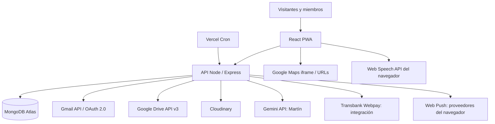
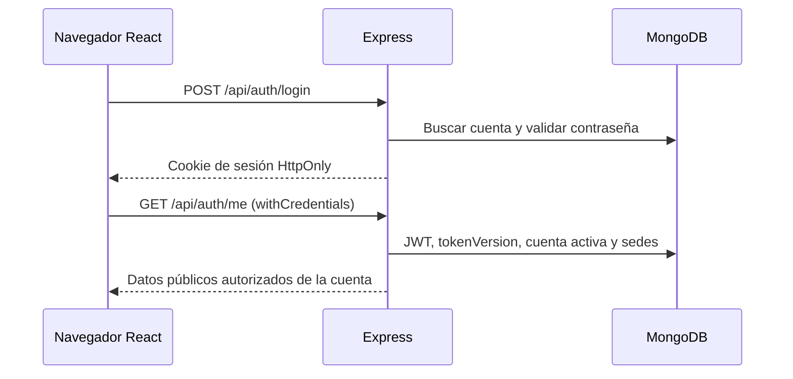
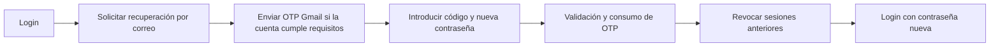
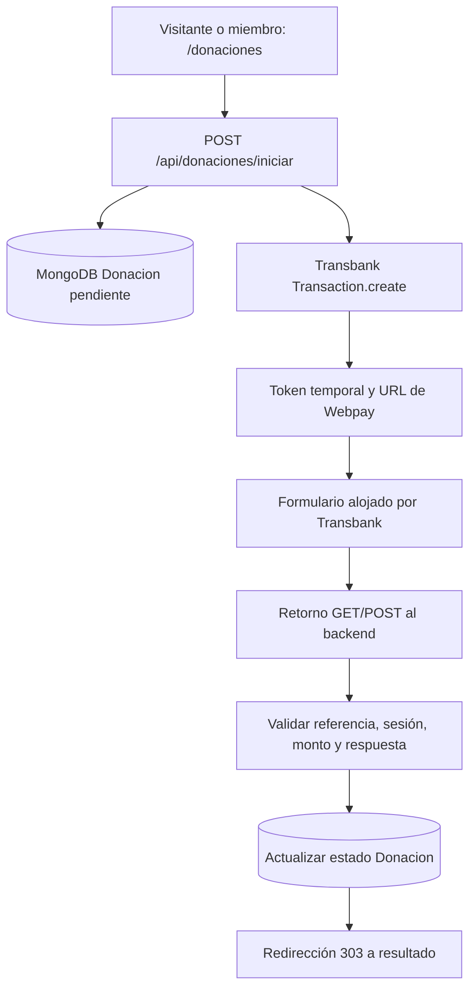
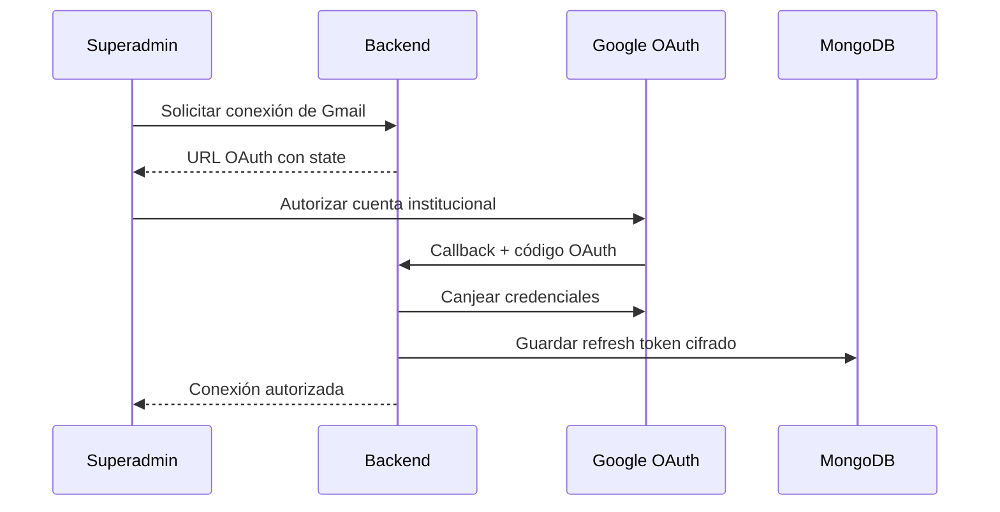
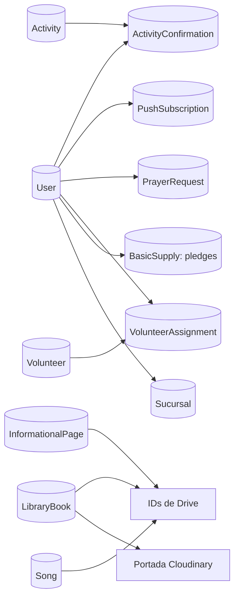

# ⚓ Iglesia El Ancla — Plataforma Web Progresiva (PWA)

> **Documentación técnica integral para desarrolladores y responsables de mantenimiento**  
> **Organización:** Iglesia El Ancla Comunidad Cristiana · Valparaíso, Chile  
> **Repositorio:** [lissmi/iglesia-el-ancla](https://github.com/lissmi/iglesia-el-ancla)  
> **Sitio:** [iglesia-el-ancla.vercel.app](https://iglesia-el-ancla.vercel.app)  
> **Actualización de esta documentación:** 10 de noviembre de 2026  
> **Idioma de la aplicación:** español · **Zona horaria de referencia:** `America/Santiago`

**El Ancla** es una aplicación web progresiva para comunicar actividades, acompañar a sus miembros y digitalizar procesos de gestión de una comunidad cristiana. Combina páginas públicas, un espacio personal para miembros y paneles administrativos con permisos diferenciados. Integra servicios externos para correo institucional, almacenamiento de archivos, imágenes, asistencia con IA, notificaciones push, navegación geográfica y aportes de prueba.

Este documento está pensado para una persona que **nunca ha trabajado en el repositorio**: explica la arquitectura, dónde vive cada módulo, sus modelos y rutas, cómo instalarlo, cómo funcionan sus proveedores externos, qué controles de seguridad existen y cómo diagnosticar problemas frecuentes.

> [!IMPORTANT]
> **Estado y alcance de la evidencia.** Esta documentación se elaboró contrastando el inventario de código facilitado para esta revisión (incluye 554 entradas de archivos), los documentos técnicos incluidos en él y las pruebas funcionales comunicadas por el equipo. **No equivale a una auditoría de seguridad ni garantiza que todos los flujos estén listos para producción.** Las variables efectivas de Vercel, los datos privados de MongoDB y el resultado de despliegues posteriores deben comprobarse en cada entorno. Donde hablamos de «valor predeterminado», nos referimos al valor escrito en el código, que una variable de entorno puede sustituir.

> [!CAUTION]
> **Nunca publiques credenciales.** Este README incluye únicamente **nombres** de variables, ejemplos ficticios y comandos. No copies aquí `.env`, secretos JWT, claves VAPID privadas, claves de Cloudinary, tokens de Google, contraseñas, códigos OTP, enlaces privados de Drive ni datos personales de los miembros. El repositorio se presenta como **público**: revisa también el historial de Git.

---

## Índice de navegación

1. [Qué problema resuelve y objetivos](#1-qué-problema-resuelve-y-objetivos)
2. [Alcance y estado de los módulos](#2-alcance-y-estado-de-los-módulos)
3. [Tecnologías y dependencias](#3-tecnologías-y-dependencias)
4. [Arquitectura general y flujos](#4-arquitectura-general-y-flujos)
5. [Organización del repositorio](#5-organización-del-repositorio)
6. [Instalación local desde cero](#6-instalación-local-desde-cero)
7. [Variables de entorno y configuración](#7-variables-de-entorno-y-configuración)
8. [Autenticación, roles y sucursales](#8-autenticación-roles-y-sucursales)
9. [Alta y recuperación de cuentas](#9-alta-y-recuperación-de-cuentas)
10. [Páginas públicas y editor institucional](#10-páginas-públicas-y-editor-institucional)
11. [Actividades, eventos y confirmaciones](#11-actividades-eventos-y-confirmaciones)
12. [Voluntariado y turnos](#12-voluntariado-y-turnos)
13. [Peticiones de oración](#13-peticiones-de-oración)
14. [Inventario y colaboración comunitaria](#14-inventario-y-colaboración-comunitaria)
15. [Finanzas, ingresos y gastos](#15-finanzas-ingresos-y-gastos)
16. [Donaciones con Webpay Plus](#16-donaciones-con-webpay-plus)
17. [Biblioteca, cancionero y recursos](#17-biblioteca-cancionero-y-recursos)
18. [Lector bíblico y accesibilidad](#18-lector-bíblico-y-accesibilidad)
19. [Martín: asistente Google Gemini](#19-martín-asistente-google-gemini)
20. [Google Drive: archivos institucionales](#20-google-drive-archivos-institucionales)
21. [Cloudinary: imágenes y limpieza](#21-cloudinary-imágenes-y-limpieza)
22. [Gmail API y OAuth 2.0](#22-gmail-api-y-oauth-20)
23. [PWA, Service Worker y Web Push](#23-pwa-service-worker-y-web-push)
24. [Notificaciones unificadas](#24-notificaciones-unificadas)
25. [Google Maps sin facturación](#25-google-maps-sin-facturación)
26. [Despliegue, Vercel y cron](#26-despliegue-vercel-y-cron)
27. [Seguridad y privacidad](#27-seguridad-y-privacidad)
28. [Pruebas y criterios de aceptación](#28-pruebas-y-criterios-de-aceptación)
29. [Diagnóstico de problemas](#29-diagnóstico-de-problemas)
30. [Guía para contribuir y mantener](#30-guía-para-contribuir-y-mantener)
31. [Limitaciones conocidas y hoja de ruta](#31-limitaciones-conocidas-y-hoja-de-ruta)
32. [Anexo A: rutas frontend](#anexo-a-rutas-frontend)
33. [Anexo B: catálogo de API Express](#anexo-b-catálogo-de-api-express)
34. [Anexo C: modelos MongoDB](#anexo-c-modelos-mongodb)
35. [Anexo D: scripts y utilidades](#anexo-d-scripts-y-utilidades)
36. [Anexo E: dependencias declaradas](#anexo-e-dependencias-declaradas)
37. [Glosario y recursos para el equipo](#glosario-y-recursos-para-el-equipo)

---

## 1. Qué problema resuelve y objetivos

Antes de la PWA, buena parte de la comunicación, la programación de reuniones, los compromisos de asistencia, la distribución de recursos y el seguimiento administrativo dependían de canales y documentos separados. El proyecto busca **reducir la dispersión de información y el trabajo manual** sin imponer a una organización comunitaria una infraestructura costosa.

Objetivos funcionales principales:

- **Comunicación pública:** presentar la iglesia, horarios, información de contacto, reuniones, condiciones, privacidad y donaciones.
- **Participación:** que miembros autenticados consulten actividades, confirmen asistencia, conozcan turnos y acompañen peticiones de oración.
- **Gestión:** facilitar el registro de usuarios, administradores, sedes, eventos, insumos, bienes, finanzas, contenido y recursos.
- **Accesibilidad:** lectura asistida, interfaz adaptable a pantallas móviles, navegación clara y una instalación PWA sin pasar por tiendas de aplicaciones.
- **Automatización:** invitaciones por correo, recuperación de cuenta, avisos push y recordatorios respetuosos.
- **Sostenibilidad:** reutilizar los niveles gratuitos y los recursos ya disponibles cuando sea viable, sin confundir **prototipos de integración** con servicios comerciales habilitados.

El sistema **no es** un proveedor bancario, una herramienta clínica, un sistema de emergencias ni un repositorio público de información sensible. La autorización y la exposición de contenidos son responsabilidades del backend.

## 2. Alcance y estado de los módulos

La siguiente clasificación distingue la existencia de código de la evidencia de pruebas completas:

| Área | Capacidades presentes | Situación documentada |
|---|---|---|
| Sitio público | Inicio, Nosotros, Eventos, Contacto, Donaciones, Términos y Privacidad | Integrado en React; Google Maps probado visualmente en `/contacto` |
| Cuentas | Login, logout, perfiles, roles, invitación y activación | Código presente; flujos de acceso y recuperación probados durante desarrollo |
| Recuperación | OTP al correo, nueva contraseña e invalidación de sesiones | Prueba completa de usuario reportada como correcta |
| Membresía | Inicio personal, actividades, recursos, oración, voluntariado y finanzas autorizadas | Rutas y componentes implementados |
| Administración | Usuarios, miembros, actividades, eventos, voluntarios, recursos, contenidos, ingresos, gastos, inventario | Módulos y routers presentes; cada operación requiere sus propias pruebas |
| Superadministración | Administradores, permisos, sucursales, políticas y configuración | Rutas exclusivas de `super_admin` |
| Martín | Menú guiado, configuración, conocimiento editorial y chat con Gemini | Implementación presente; disponibilidad depende de API, modelo y habilitación |
| Gmail | Correo institucional vía OAuth 2.0, invitaciones, OTP, recordatorios | Integración y recepción de correos comprobadas |
| Drive | Archivos de biblioteca, letras, PDFs y contenido editorial | Integración implementada; exige carpetas y OAuth correctos |
| Cloudinary | Portadas e imágenes de contenidos | Integración implementada; requiere credenciales |
| Web Push | PWA, consentimiento, suscripciones, avisos automáticos, cron | Avisos automáticos de oración y publicación de actividad comprobados en Samsung |
| Notificaciones internas | Bandeja unificada con leídos persistentes por cuenta | Probada visualmente con roles y espacios compartidos |
| Google Maps | Mapa incrustado y enlace «Cómo llegar» | Confirmado en la página pública; **sin Maps Embed API ni facturación** |
| Webpay Plus | Inicio, retorno, estados y conciliación de donaciones | **Ambiente de integración**; no habilitado para cobrar dinero real |

> **Regla de documentación:** que un módulo tenga rutas, pruebas unitarias o una interfaz terminada **no significa** que se haya comprobado contra todos los proveedores externos, dispositivos y casos adversos.

## 3. Tecnologías y dependencias

### 3.1. Stack principal

| Capa | Tecnología | Propósito |
|---|---|---|
| UI | **React 19**, JavaScript, JSX, HTML5, CSS3 | Vistas y componentes reutilizables |
| Rutas | **React Router 7** | Navegación pública, protegida y basada en roles |
| HTTP cliente | **Axios** | Solicitudes al backend con cookies |
| Iconografía | **Lucide React** y recursos gráficos locales | Interfaz y símbolos |
| Gráficos | **Recharts** | Estadísticas administrativas y financieras |
| Compilación | **Create React App / react-scripts 5** | Build del frontend actual |
| API | **Node.js + Express 5 (ES Modules)** | Validación, negocio, rutas y coordinación de proveedores |
| Base de datos | **MongoDB Atlas + Mongoose 8** | Usuarios, actividades, finanzas, metadatos y auditoría |
| Autenticación | **JWT + cookies HttpOnly + bcryptjs** | Sesiones y hashes de contraseña |
| IA | **Google Gemini**, SDK `@google/genai` | Asistente Martín; el modelo puede configurarse |
| Correo | **Gmail API**, `googleapis`, `nodemailer` | Mensajes institucionales por OAuth 2.0 |
| Archivos | **Google Drive API v3** | Guardar documentos privados y contenido editorial |
| Imágenes | **Cloudinary** | Imágenes en CDN, subidas y limpieza |
| PWA | Manifest + Service Worker + Push API | Instalación, funcionamiento cliente y avisos |
| Push servidor | **web-push + VAPID** | Envío autenticado a proveedores push |
| Pagos de prueba | **Transbank Webpay Plus / transbank-sdk** | Donaciones en ambiente de integración |
| Mapas | **Google Maps: iframe compartido + Maps URLs** | Mapa público y enlace de indicaciones sin clave |
| Documentos | PDFKit, pdf-lib, ExcelJS, JSZip | PDFs, exportaciones y paquetes documentales |
| Despliegue | **Vercel** | Frontend, backend y tareas programadas |
| Código | **Git y GitHub** | Control de cambios y colaboración |

Las versiones de la tabla son las versiones **declaradas** en `package.json` de la instantánea. La versión instalada exacta se determina con `package-lock.json`/`npm ci`.

### 3.2. Decisiones de arquitectura

- **Cliente–servidor:** React no conecta directamente con MongoDB ni expone claves de proveedores privados.
- **Monorepositorio:** `frontend/` y `backend/` son aplicaciones independientes dentro del mismo repositorio.
- **API REST principalmente JSON**, con `multipart/form-data` para imágenes/documentos y streaming para archivos.
- **Modelo de sesión unificado:** `member`, `admin` y `super_admin` provienen del mismo modelo `User`.
- **Contenido donde corresponde:** documentos binarios en Drive, imágenes en Cloudinary y metadatos/transacciones en MongoDB.
- **Sin duplicaciones innecesarias:** el sistema de notificaciones deriva avisos de los modelos existentes en lugar de guardar una copia de cada aviso en una colección masiva.
- **Fechas locales explícitas:** para actividades y límites diarios se utiliza `America/Santiago`, no la zona horaria de las máquinas de Vercel.

## 4. Arquitectura general y flujos



**Una solicitud normal** recorre: componente React → servicio Axios (`frontend/src/services/api.js`) → middleware Express → ruta → modelo/servicio → JSON. El backend decide la autorización y la visibilidad de cada registro. Los botones y rutas ocultos en React mejoran la experiencia, pero **no constituyen autorización**.

**Una operación con proveedor externo** agrega una etapa en el servidor. Por ejemplo, subir un libro requiere validar el archivo, enviar su portada a Cloudinary, almacenar el documento en Drive y guardar los metadatos en `LibraryBook`. Los controladores contemplan limpieza compensatoria cuando algo falla.

**Una PWA cerrada** puede recibir push si el navegador, el sistema operativo y la suscripción lo permiten: el disparador ocurre en Express, Web Push transporta el mensaje y el Service Worker atiende el evento en el dispositivo.

### Fronteras de confianza

| Límite | Se permite | No se debe permitir |
|---|---|---|
| Visitante → React | Ver contenido publicado y páginas públicas | Acceder a datos privados por conocer una URL |
| React → Express | Solicitar operaciones con cookie autenticada | Afirmar el rol enviando `role: 'admin'` en el JSON |
| Express → MongoDB | Buscar datos autorizados por cuenta, rol y sucursal | Entregar hashes, tokens o índices internos sin necesidad |
| Express → Gemini | Contexto editorial aprobado y conversación acotada | Enviar documentos privados, cookies, información financiera o secretos |
| Express → Gmail/Drive/Cloudinary | Usar credenciales del servidor | Llevar secretos de OAuth o API secret al frontend |
| Service Worker → dispositivo | Mostrar mensajes generales consentidos | Incluir texto privado en pantalla bloqueada |

## 5. Organización del repositorio

```text
iglesia-el-ancla/
├── backend/
│   ├── docs/                     # Documentación especializada de Gmail y Webpay
│   ├── package.json
│   ├── server.js                 # Bootstrap; conexión a Mongo y Express
│   ├── src/
│   │   ├── app.js                # Seguridad global y montaje de routers
│   │   ├── config/              # MongoDB y políticas
│   │   ├── data/                # Biblia local y contenidos fijos de Martín
│   │   ├── middleware/          # Auth, autorización, sucursal, origen
│   │   ├── models/              # Esquemas Mongoose
│   │   ├── routes/              # Endpoints organizados por dominio
│   │   ├── services/            # Integraciones y reglas de negocio
│   │   ├── scripts/             # Operación, auditorías, inicialización
│   │   └── utils/               # Herramientas compartidas
│   └── tests/                   # Pruebas con node:test
├── frontend/
│   ├── package.json
│   ├── public/                   # Manifest, iconos y Service Worker de PWA
│   └── src/
│       ├── App.js               # Árbol de rutas y proveedores globales
│       ├── index.js             # Entrada de React y registro de PWA
│       ├── components/          # Componentes UI por módulo y rol
│       ├── context/             # Estado compartido
│       ├── data/                # Valores auxiliares y demos
│       ├── hooks/               # Obtención reutilizable de datos
│       ├── pages/               # Páginas públicas, miembro y administrativas
│       ├── pwa/                 # Registro Service Worker
│       ├── routes/              # Árbol de páginas administrativas compartidas
│       ├── services/            # API client y wrappers por dominio
│       ├── styles/              # CSS organizado por responsabilidades
│       └── utils/               # Mapas, firma, utilidades de interfaz
├── scripts/                     # Automatizaciones del repositorio
├── vercel.json                   # Servicios, rewrites y cron
└── README.md                     # Este documento
```

**Ruta para encontrar un fallo:** primero la página (`pages/`), después su servicio (`frontend/src/services/`), después el router Express (`backend/src/routes/`), luego el servicio de negocio (`backend/src/services/`) y el modelo (`backend/src/models/`). Esta secuencia evita corregir una respuesta API equivocada solo ocultándola con CSS.

## 6. Instalación local desde cero

### 6.1. Requisitos

- Node.js y npm compatibles con las versiones fijadas del proyecto (en pruebas de Webpay se utilizó Node.js 20; comprobar las dependencias y el requisito de `--env-file`).
- Git y acceso al repositorio.
- Acceso autorizado a MongoDB Atlas y, para probar integraciones externas, las credenciales de prueba/institucionales correspondientes.
- Navegador moderno para React y PWA (Chrome, Edge, Opera u otro compatible).
- Dos terminales: backend y frontend. En el proyecto local se usan normalmente **5000** y **3000**.

### 6.2. Clonar e instalar

```powershell
# Obtener el repositorio desde GitHub.
git clone https://github.com/lissmi/iglesia-el-ancla.git

# Entrar a la raíz del proyecto.
cd iglesia-el-ancla

# Instalar dependencias del backend según el lockfile, si existe.
cd backend
npm ci

# Instalar las dependencias del frontend.
cd ../frontend
npm ci
```

Si el repositorio no contiene el `package-lock.json` esperado, usar `npm install` y solicitar revisión del lockfile al equipo; no eliminarlo sin motivo.

### 6.3. Preparar el backend

Crear **localmente** `backend/src/middleware/.env` con las variables autorizadas para el entorno. Esta ubicación es una decisión del proyecto: el script `npm start` del backend ejecuta `node --env-file=./src/middleware/.env server.js`. **La ubicación del `.env` no sustituye `.gitignore`, permisos de acceso ni la protección de los secretos.**

```powershell
# Terminal 1.
cd backend
npm run dev

# Alternativa sin nodemon.
# npm start
```

La secuencia de inicio conecta MongoDB y luego abre el puerto local. Si MongoDB no está disponible, la aplicación no debe anunciar un inicio correcto.

Comprobar salud del backend en `http://localhost:5000/api/status`. La respuesta incluye `success`, `status: 'online'`, entorno y fecha del servidor.

### 6.4. Preparar el frontend

Crear `frontend/.env.local` con la URL de la API local y, si procede, la URL del mapa compartido. En terminal independiente:

```powershell
# Terminal 2.
cd frontend
npm start
```

Abrir `http://localhost:3000`. La aplicación incluye rutas públicas, login y paneles sujetos a sesión. Reiniciar React tras modificar variables `REACT_APP_*`.

### 6.5. Comprobación inicial recomendada

1. La API responde `200` en `/api/status`.
2. La página pública abre sin sesión.
3. El login entrega la sesión de prueba correspondiente.
4. `/member` abre con `member`, `admin` o `super_admin` autorizados.
5. `/admin` no abre con una cuenta `member`.
6. `/super-admin` exige exactamente `super_admin`.
7. Los datos de un panel provienen del backend y no de datos de ejemplo.
8. Los avisos privados no aparecen al navegar como invitado.

## 7. Variables de entorno y configuración

> Los valores que comienzan por `CAMBIAR_` son **marcadores de ejemplo**; nunca son claves funcionales. Algunos servicios son opcionales: configure solo los que se necesiten para las pruebas de ese entorno. No publiques un `.env` completo.

### 7.1. Backend: `backend/src/middleware/.env` en desarrollo

```dotenv
# Entorno y servidor
NODE_ENV=development
PORT=5000
FRONTEND_URL=http://localhost:3000
# FRONTEND_URL_PRODUCTION=https://iglesia-el-ancla.vercel.app
# ACTIVATION_FRONTEND_URL=http://localhost:3000

# Base de datos
MONGODB_URI=CAMBIAR_URI_PRIVADA_MONGODB

# Sesiones y seguridad
JWT_SECRET=CAMBIAR_SECRETO_ALEATORIO_FUERTE
JWT_EXPIRES_IN=4h
EMAIL_VERIFICATION_HMAC_KEY=CAMBIAR_CLAVE_INDEPENDIENTE

# Gmail institucional: OAuth de envío y cifrado del token
GOOGLE_CLIENT_ID=CAMBIAR_GOOGLE_CLIENT_ID
GOOGLE_CLIENT_SECRET=CAMBIAR_GOOGLE_CLIENT_SECRET
GOOGLE_REDIRECT_URI=http://localhost:5000/api/auth/google/callback
GMAIL_SENDER_EMAIL=CAMBIAR_CORREO_INSTITUCIONAL
GOOGLE_TOKEN_ENCRYPTION_KEY=CAMBIAR_CLAVE_CIFRADO_INDEPENDIENTE

# Google Drive: OAuth y carpetas de archivos
GOOGLE_DRIVE_CLIENT_ID=CAMBIAR_DRIVE_CLIENT_ID
GOOGLE_DRIVE_CLIENT_SECRET=CAMBIAR_DRIVE_CLIENT_SECRET
GOOGLE_DRIVE_REFRESH_TOKEN=CAMBIAR_REFRESH_TOKEN
GOOGLE_DRIVE_FOLDER_ID=CAMBIAR_CARPETA_BIBLIOTECA
GOOGLE_DRIVE_SONGBOOK_FOLDER_ID=CAMBIAR_CARPETA_CANCIONERO
GOOGLE_DRIVE_INFORMATIONAL_PAGES_FOLDER_ID=CAMBIAR_CARPETA_PAGINAS
GOOGLE_DRIVE_RESOURCES_FOLDER_ID=CAMBIAR_CARPETA_RECURSOS

# Cloudinary
CLOUDINARY_CLOUD_NAME=CAMBIAR_CLOUD_NAME
CLOUDINARY_API_KEY=CAMBIAR_CLOUDINARY_KEY
CLOUDINARY_API_SECRET=CAMBIAR_CLOUDINARY_SECRET

# Asistente Martín — Google Gemini
GEMINI_API_KEY=CAMBIAR_GEMINI_API_KEY
GEMINI_MODEL=gemini-3.5-flash-lite

# Notificaciones Web Push
VAPID_PUBLIC_KEY=CAMBIAR_VAPID_PUBLIC_KEY
VAPID_PRIVATE_KEY=CAMBIAR_VAPID_PRIVATE_KEY
VAPID_SUBJECT=mailto:correo-institucional@example.org
PUSH_AUTOMATIC_ENABLED=false
CRON_SECRET=CAMBIAR_SECRETO_ALEATORIO_DE_32_CARACTERES_O_MAS

# Donaciones exclusivamente en integración
TRANSBANK_ENVIRONMENT=integration
WEBPAY_RETURN_URL=http://localhost:5000/api/donaciones/webpay/retorno
```

**Nota sobre VAPID:** las variables `VAPID_*` están documentadas porque `pushService.js` las utiliza; son distintas del `CRON_SECRET`. El VAPID público puede exponerse al cliente, **el privado nunca**. Para envío automático, activar `PUSH_AUTOMATIC_ENABLED=true` solo en un entorno controlado.

**Nota sobre Gemini:** `gemini-3.5-flash-lite` es el **fallback literal del código** en `martinService.js`, no una confirmación del valor de `GEMINI_MODEL` desplegado ni de la disponibilidad actual del modelo en tu cuenta de Google. Para conocer el modelo realmente usado en Vercel, revisar la variable de entorno de ese despliegue y la compatibilidad con el proveedor.

**Nota sobre el cron:** la clave debe ser larga, aleatoria y **distinta de** JWT, Gmail, Drive y VAPID. No enviarla mediante query strings ni colocarla en el código React.

### 7.2. Frontend: `frontend/.env.local`

```dotenv
# API de Express en desarrollo.
REACT_APP_API_URL=http://localhost:5000/api

# URL obtenida con Google Maps > Compartir > Insertar un mapa.
# Pegar aquí la URL completa del atributo src del iframe.
REACT_APP_GOOGLE_MAPS_EMBED_URL=CAMBIAR_URL_PUBLICA_MAPS_EMBED
```

La URL de inserción compartida no es una contraseña. En la integración elegida **no hace falta** `REACT_APP_GOOGLE_MAPS_EMBED_API_KEY`; no se activó Google Maps Platform facturable para este caso.

### 7.3. Dónde se usan y cómo obtenerlas

| Familia | Ubicación/archivo principal | Cuándo es necesaria |
|---|---|---|
| `MONGODB_URI` | `config/database.js` | Siempre que el backend acceda a modelos |
| `JWT_*` | `utils/tokenUtils.js` | Login y endpoints autenticados |
| `FRONTEND_URL*` | `app.js`, `validateRequestOrigin.js` y algunas rutas | CORS, origen de escritura y enlaces |
| `GOOGLE_CLIENT_*`, `GOOGLE_REDIRECT_URI` | `services/mail/googleOAuthClient.js` | Autorizar Gmail institucional |
| `GMAIL_SENDER_EMAIL` | `services/mail/` | Verificar remitente |
| `GOOGLE_TOKEN_ENCRYPTION_KEY` | `services/mail/googleTokenEncryption.js` | Cifrar refresh token Gmail guardado |
| `EMAIL_VERIFICATION_HMAC_KEY` | Servicios OTP | Guardar verificador criptográfico del código |
| `GOOGLE_DRIVE_*` | `services/drive/googleDrive.js` | Archivos y documentos privados |
| `CLOUDINARY_*` | `services/cloudinary/cloudinary.js` | Imágenes y portadas |
| `GEMINI_API_KEY`, `GEMINI_MODEL` | `services/martin/martinService.js` | Chat IA con Martín |
| `VAPID_*` | `services/push/pushService.js` | Suscripciones y envíos Web Push |
| `PUSH_AUTOMATIC_ENABLED`, `CRON_SECRET` | `automaticPushService.js`, `pushRoutes.js` | Automatización y cron seguro |
| `TRANSBANK_ENVIRONMENT`, `WEBPAY_RETURN_URL` | `services/webpay/` | Webpay en integración |
| `REACT_APP_API_URL` | `frontend/src/services/api.js` | Comunicación con Express |
| `REACT_APP_GOOGLE_MAPS_EMBED_URL` | Módulo de contacto/mapas del frontend | Mapa sin API key |

### 7.4. Reglas de seguridad de configuración

- En Vercel, configurar las variables en **Settings → Environment Variables**, separando ambientes cuando proceda. Nuevos valores exigen nuevo despliegue para aplicarse.
- No incluir claves de Drive/Gmail en variables `REACT_APP_*`; las variables compiladas de React son visibles para quien inspeccione el frontend.
- No activar pagos productivos cambiando solo `TRANSBANK_ENVIRONMENT`; el módulo requiere habilitación y auditoría adicional.
- No imprimir `.env`, cuerpos de formularios con contraseña, OTP ni tokens en consola o logs.
- Si una credencial se publicó accidentalmente, **revocarla y rotarla**. Agregarla después a `.gitignore` no elimina el secreto del historial.

## 8. Autenticación, roles y sucursales

### 8.1. Identidad central

Existe **un único modelo `User`** (`backend/src/models/User.js`) para los roles `member`, `admin` y `super_admin`. La cuenta tiene un rol efectivo, estado activo, datos personales, verificación de correo, control de intentos, `tokenVersion` y asignaciones de sucursales.

| Rol | Propósito | Acceso destacado |
|---|---|---|
| Invitado | Visitante sin sesión | Rutas públicas; **sin campana privada** |
| `member` | Participante registrado | `/member`, recursos, confirmaciones y avisos autorizados |
| `admin` | Gestión delegada | `/admin` y **también** su espacio de miembro; permisos administrativos validados por servidor |
| `super_admin` | Administración central | `/super-admin` y espacio de miembro; configuración y roles exclusivos |

**Un administrador también es miembro de la comunidad.** Por ese motivo la sesión y las notificaciones no se duplican por panel: una misma cuenta puede navegar entre páginas públicas autenticadas, su espacio personal y el panel autorizado.

### 8.2. Sesión y middleware



- `loginRoutes.js` implementa login, `/me` y logout.
- `authenticateUser.js` verifica JWT, busca al usuario y exige una cuenta activa, una versión de sesión válida y sucursales habilitadas.
- `authorizeRoles.js` compara el rol **del usuario recuperado por el backend**, no el rol enviado desde React.
- `authorizeSucursal.js` exige una sede asignada y activa; **incluso `super_admin`** requiere estar autorizado para la sede operativa en las rutas que lo utilicen.
- `ProtectedRoute.jsx` evita mostrar vistas a un rol incorrecto, pero es un control de navegación complementario al backend.
- `SessionAwareHeader.jsx` consulta el usuario reconocido por el proveedor de notificaciones: invitado → encabezado público sin avisos privados.

### 8.3. Política de login

El archivo `backend/src/config/loginSecurityPolicy.js` declara:

- **5 contraseñas incorrectas** antes de bloqueo temporal de cuenta.
- Bloqueo por **15 minutos**.
- Limitador de intentos de login por IP: **10 solicitudes en 15 minutos**.
- Existe además un limitador general en `app.js` de **200 solicitudes por IP cada 15 minutos**. Los módulos pueden aplicar límites más estrictos.

La cookie y sus atributos definitivos se configuran en `utils/tokenUtils.js` y las rutas de autenticación; verificar `Secure`, `SameSite`, dominios y HTTPS en el despliegue. El dato `tokenVersion` permite invalidar JWT anteriores cuando cambia una condición de seguridad.

### 8.4. Sucursales

El modelo `Sucursal` contiene nombre, código, slug, dirección, contacto, zona horaria, estado y condición de sede principal. `User` mantiene `sucursales` y `sucursalPrincipal`. El backend consulta esas relaciones antes de permitir operaciones con alcance territorial. Una sede desactivada no debe mantenerse como contexto autorizado de una sesión.

## 9. Alta y recuperación de cuentas

### 9.1. Registro por invitación

Un administrador autorizado registra a una persona desde el panel. La invitación usa correo institucional y un token de activación de un solo uso; el usuario abre `/activar-cuenta` y establece su contraseña. La ruta pública del backend es `POST /api/auth/account-activation/complete`, que comprueba el token, el estado de cuenta y la política de contraseñas antes de activarla.

El código de activación **no almacena el token original legible**: usa un verificador hash y lo consume para impedir la reutilización. La posibilidad de reenviar la invitación está limitada y protegida por roles.

### 9.2. Cambiar contraseña estando autenticado

Flujo **distinto** de «olvidé mi contraseña»:

1. El usuario autenticado solicita un OTP en `POST /api/auth/change-password/request-code`.
2. Gmail envía el código de seis dígitos al correo verificado de la cuenta.
3. El usuario presenta código, contraseña actual y nueva contraseña a `POST /api/auth/change-password`.
4. El backend valida política, intención, vigencia, intentos y origen; consume el OTP y cambia el hash.
5. Se incrementa `tokenVersion`, lo que revoca las sesiones anteriores.

La documentación histórica `backend/docs/README_GMAIL_SEGURIDAD_EL_ANCLA.md` describe la implementación inicial para administradores; **no sustituye las comprobaciones del código actual ni debe leerse como estado definitivo de todos los roles**.

### 9.3. ¿Olvidaste tu contraseña?

La recuperación pública ya está incorporada en `/recuperar-contrasena` y utiliza **el mismo modelo de códigos**, pero con propósito separado `password_reset`, para impedir que un código autorizado para otra operación se reutilice aquí.



Archivos clave: `frontend/src/pages/auth/ForgotPassword.jsx`, `backend/src/routes/passwordRecoveryRoutes.js`, `services/mail/passwordRecoveryService.js`, `passwordRecoveryPolicy.js` y `passwordRecoveryEmail.js`.

Protecciones implementadas: código de **seis dígitos**, **10 minutos** de validez, **5 intentos** máximos, al menos **60 segundos** entre envíos, verificador HMAC-SHA256 y **respuesta pública genérica** que no revela si un correo pertenece a una cuenta. Tras recuperación se revocan sesiones anteriores y suscripciones push asociadas; el usuario debe volver a iniciar sesión y reactivar las notificaciones en sus dispositivos.

El diseño del correo HTML sigue el estilo azul y arena de la iglesia y contiene un mensaje amable, vencimiento y recomendaciones de seguridad. El código **no debe aparecer en la respuesta HTTP**.

## 10. Páginas públicas y editor institucional

### 10.1. Vistas accesibles sin sesión

La PWA ofrece `/`, `/nosotros`, `/eventos`, `/contacto`, `/donaciones`, `/terminos-y-condiciones`, `/politica-de-privacidad`, `/login`, `/recuperar-contrasena` y `/activar-cuenta`.

La ausencia de sesión **no deshabilita el contenido verdaderamente público**, pero impide acceder a la bandeja privada, a las rutas de miembro y a los paneles. Un administrador autenticado puede visitar `/contacto` o `/` sin perder su identidad ni sus avisos.

### 10.2. CMS de páginas informativas: Drive + MongoDB + Cloudinary

Los editores de **Nosotros, Contacto, Términos y Privacidad** no guardan su cuerpo editorial completo directamente en MongoDB. La arquitectura separa:

1. **Google Drive:** archivos TXT con contenido JSON validado, diferenciando `draft` (borrador) y `published` (publicado).
2. **MongoDB (`InformationalPage`):** referencias `draftFileId`/`publishedFileId`, revisiones, responsables y marcas de publicación.
3. **Cloudinary:** imágenes que el editor necesita mostrar.
4. **Express:** valida estructura, roles y origen; resuelve los archivos desde Drive sin exponer IDs internos.
5. **React:** los hooks de páginas públicas cargan únicamente la versión publicada.

El módulo `informationalPagesDriveService.js` utiliza bloqueos temporales de edición, revisiones y nombres controlados de archivo. No se permiten nombres arbitrarios proporcionados por el navegador. Las imágenes ya no referenciadas por ninguno de los dos estados pueden eliminarse con el servicio `informationalPagesImages.js`.

**Límites importantes en código:** archivos editoriales TXT de hasta **150 KiB**; imágenes de **5 MiB** como máximo, formatos JPG/PNG/WebP identificados por contenido, no solo por extensión.

### 10.3. Configuración de la página Eventos

`eventRoutes.js` también administra la presentación editorial de eventos, incluyendo borrador y publicación. Las **reuniones recurrentes** no deben confundirse con las **actividades puntuales** que solicitan confirmación.

## 11. Actividades, eventos y confirmaciones

### 11.1. Diferencia funcional

| Concepto | Modelo | Características |
|---|---|---|
| **Actividad puntual** | `Activity` | Fecha/hora concreta, modalidad, capacidad, imagen, cooperación opcional y posible confirmación de asistencia |
| **Confirmación de actividad** | `ActivityConfirmation` | Una participación por miembro y actividad; puede incluir contribuciones/compromisos |
| **Evento o reunión recurrente** | `Event` | Repetición semanal/mensual, días de semana y reglas de recurrencia; lectura pública |

El backend controla borrador/publicación. Las actividades exigen autenticación; los eventos recurrentes publicados pueden verse públicamente. Una actividad sin publicar **no debe** generar avisos comunitarios ni confirmaciones públicas.

### 11.2. Confirmaciones y cupos

El router `activityAttendanceRoutes.js` se monta **dentro de** `activitiesRoutes.js`. Se encarga de confirmar o retirar participación, consultar el estado individual, registrar contribuciones y generar reportes administrativos. Usa `ActivityConfirmation` en lugar de duplicar participantes directamente dentro del documento `Activity`.

Los administradores pueden consultar confirmaciones y descargar informes; un miembro solo puede actuar sobre su propia asistencia autorizada. Los reportes utilizan PDFKit y ExcelJS.

### 11.3. Avisos de cambios

Publicar una actividad, publicarla después de estar en borrador o actualizar su programación puede emitir un push automático genérico. Para evitar exponer información en pantallas bloqueadas, **el push no incorpora títulos privados ni nombres personales**: invita a abrir la PWA y revisar los detalles con sesión.

## 12. Voluntariado y turnos

El sistema coordina equipos, integrantes, asignaciones y confirmación de servicios:

- `Volunteer`: pertenencia de un miembro a equipos o ministerios.
- `VolunteerAssignment`: fecha, horario, título, sede, participantes y respuesta individual.
- `volunteerRoutes.js`: consultas personales (`/me/assignments`), aceptar o rechazar turnos, gestionar equipos y administrar asignaciones.
- `memberVolunteerAlerts.js`: derivados de asignaciones que ayudan a mostrar avisos en la experiencia de miembro.
- `volunteerReminderService.js`: recordatorios por Gmail, con marcadores de envío y mecanismo de reclamación para reducir duplicados.
- `volunteerReminderCronRoutes.js`: endpoint privado para el planificador, protegido mediante `CRON_SECRET`.

El archivo `vercel.json` de la instantánea define expresamente el cron de **push comunitario**. La existencia de `volunteerReminderCronRoutes.js` **no demuestra por sí sola que exista otro cron programado o que ese router esté montado en `app.js`**; antes de confiar en recordatorios de correo automáticos, revisar montaje y programación efectivos.

## 13. Peticiones de oración

`PrayerRequest.js` gestiona título, descripción, categoría, visibilidad, anonimato, estado, seguimiento y miembros que acompañan en oración. Separamos **peticiones comunitarias** de **peticiones privadas**.

- El miembro autorizado crea, edita, elimina o acompaña peticiones según las reglas del backend.
- Administración consulta y gestiona las solicitudes dentro de los permisos correspondientes.
- La bandeja comunitaria usa un aviso genérico para una petición reciente, sin revelar su contenido personal.
- Un push sobre una petición privada **solo puede dirigirse a roles administrativos autorizados** y debe usar un texto general sin nombres, títulos, motivos íntimos ni mensajes completos.
- La lógica de avisos comunitarios **excluye por defecto peticiones creadas por la propia cuenta** cuando corresponde a la regla de destinatarios; no es un error que una cuenta no reciba una notificación de algo que acaba de publicar.

> **Privacidad:** la palabra «anónima» en la interfaz no significa que la petición deba quedar publicada sin controles. Validar siempre `visibility`, rol, autor y estado desde Express; no copiar documentos de petición dentro de una notificación push.

## 14. Inventario y colaboración comunitaria

### 14.1. Insumos básicos

El modelo `BasicSupply` guarda nombre, categoría, `stock`, `minimumStock`, notas, compromisos de miembros (*pledges*) y movimientos. Dos vistas comparten la información, pero con permisos diferentes:

- **Administración:** registra y modifica existencias, movimientos, mínimos y recepción de aportes.
- **Miembro:** consulta insumos que necesitan apoyo y puede comprometer cantidades.

La consulta `/api/basic-supplies/needs` entrega necesidades permitidas al usuario autenticado. La campana deriva avisos de stock bajo y **no debe tratar una API fallida como «no hay necesidades»**. Un ítem repuesto debe dejar de alertar al actualizar los datos.

### 14.2. Bienes de la organización

`Belonging` almacena bienes, cantidad, condición y movimientos históricos. `belongingRoutes.js` implementa inventario y movimientos bajo autorización. Mantener separadas las categorías «insumos consumibles» y «bienes patrimoniales» evita cálculos ambiguos de disponibilidad y estado.

## 15. Finanzas, ingresos y gastos

`Income` y `Expense` son modelos separados. El backend registra categorías, importe, fechas, medios de pago, estado, responsables, recibos y auditoría de modificaciones según el módulo. `DeletionLog` mantiene trazabilidad de eliminaciones de recursos relevantes.

- **Ingresos:** `incomeRoutes.js`, componentes y paneles de `IncomeManagement`.
- **Gastos:** `expenseRoutes.js`, fechas de vencimiento, estados pagado/pendiente y recibos.
- **Vista financiera consolidada:** `financeOverviewRoutes.js` con lectura autorizada y exportaciones PDF/Excel.
- **Avisos financieros:** la bandeja unificada puede derivar pagos vencidos, visibles **solo para cuentas con permisos administrativos**.

**No confundir** ingresos registrados manualmente, donaciones de prueba por Webpay y fondos realmente conciliados. Ningún estado mostrado en React sustituye la verificación de una operación bancaria.

## 16. Donaciones con Webpay Plus

### 16.1. Estado comercial

El módulo usa Transbank Webpay Plus mediante `transbank-sdk`, **en ambiente de integración**. Está diseñado para ensayar aportes, **no para recibir pagos reales**. La documentación profunda reside también en [`backend/docs/README_WEBPAY.md`](backend/docs/README_WEBPAY.md).

### 16.2. Flujo implementado



Montos descritos en el módulo de integración: sugeridos **$5.000, $10.000, $20.000 y $50.000 CLP**; personalizado de **$1.000 a $5.000.000 CLP**. Las cifras deben revisarse frente al controlador si la política comercial cambia.

El backend crea la referencia, inicia el pago, procesa retornos normales (`token_ws`) y especiales (`TBK_*`) y presenta estados `pendiente`, `iniciada`, `confirmando`, `aprobada`, `rechazada`, `anulada`, `revision` y `error`. Una operación incierta **no se considera ingreso confirmado**.

### 16.3. Conciliación

`services/webpay/` contiene el cliente, la lógica de donaciones, reglas puras de conciliación y procesamiento. `scripts/webpay/` dispone de auditoría, diagnóstico, conciliación manual en modo simulación y un trabajador local de integración.

La documentación original registra **22 pruebas automatizadas aprobadas**. La conciliación automática local **no equivale a un cron de producción**, ni cubre por sí sola las carreras entre instancias. Para cobrar realmente se requieren contrato, credenciales comerciales, autorización, reconciliación, seguridad de retornos, monitoreo y validación integral.

## 17. Biblioteca, cancionero y recursos

### 17.1. Biblioteca Solidaria

`LibraryBook` y `libraryRoutes.js` gestionan un catálogo accesible a los roles permitidos. La arquitectura es deliberadamente híbrida:

- **MongoDB:** título, autor, categoría, descripción, formato, URL de portada, referencias y responsable.
- **Cloudinary:** portada de la obra, subida y eliminación por `public_id` propio.
- **Google Drive:** documento completo (PDF o Word) en carpeta institucional.
- **Express:** autoriza y transmite la descarga privada mediante streaming; no publica el ID de Drive al navegador.

Los controladores establecen límites de **5 MiB para portada** y **20 MiB para documento**. Si falla una operación tras subir a un proveedor, intentan limpiar los archivos intermedios, y documentan los casos donde queda limpieza pendiente.

### 17.2. Cancionero de alabanzas

`Song`, `songRoutes.js` y `services/songbook/` gestionan canciones. El backend genera un **PDF institucional** y un **TXT editable** y los guarda en la carpeta de cancionero de Google Drive. En MongoDB quedan referencias `pdfFileId` y `sourceFileId`, no los archivos binarios. El endpoint de PDF transmite el archivo a miembros autorizados. Se pueden registrar metadatos como autor, categoría y un enlace externo de Spotify.

### 17.3. Centro de recursos

`ResourceContent` contiene contenidos por sección y clave, estados de borrador/publicación y visibilidad. El router `resourceContentRoutes.js` sirve:

- Material de discipulado.
- Guías de oración.
- Descargables PDF/Word almacenados en Google Drive.
- Recursos bíblicos y contenido educativo.
- Publicación, ocultación, restauración y eliminación permanente con limpieza de archivos cuando corresponde.

Los PDF de guías y materiales pueden generarse **bajo demanda** usando PDFKit, evitando duplicar archivos temporales en Drive. Los recursos ocultos o sin publicar no deben descargarse mediante enlaces directos construidos manualmente.

### 17.4. Recomendados y contenido auxiliar

`Recommendation` permite publicar recomendaciones de recursos, enlaces e imágenes con criterios de audiencia, publicación y destacado. El frontend conserva conjuntos de datos de ejemplo en `src/data/` para composiciones y valores iniciales; **no asumir que un archivo `DemoData` es la fuente de verdad de un módulo persistente**.

## 18. Lector bíblico y accesibilidad

### 18.1. Biblia local

El backend incluye un conjunto de archivos JSON por libro, bajo `backend/src/data/bible/rvr1960/books/`, identificado en el código como **RVR1960**. `bibleLocalService.js` y `bibleReaderRoutes.js` entregan catálogo, capítulos y versículos. Esta lectura local **no depende de un servicio de Biblia externo** y no requiere consultar Gemini para devolver el texto del versículo.

Las rutas permiten acceder a libros y capítulos desde el área de miembro; Martín dispone de rutas bíblicas específicas y controles sobre qué contenido devuelve. Los scripts de `src/scripts/bible/` permiten convertir, validar y auditar la estructura de versículos.

> **Licencias:** antes de distribuir públicamente archivos íntegros del texto bíblico, verificar que el equipo dispone de las autorizaciones o condiciones de licencia pertinentes para **Reina-Valera 1960**, particularmente porque el repositorio es público. Que un archivo esté en Git no demuestra permiso de redistribución.

### 18.2. Lectura asistida

`frontend/src/components/accessibility/AccessibilityReader.jsx` utiliza la **Web Speech API del navegador**: `SpeechSynthesisUtterance` y `window.speechSynthesis` permiten lectura en voz alta, pausa/reanudación y ajuste de velocidad. La preferencia de velocidad se guarda localmente cuando el navegador lo permite.

**Importante:** esto es **síntesis de voz del navegador**, no una integración con Google Cloud Text-to-Speech, Speech-to-Text ni una función propia de Gemini. La disponibilidad y las voces dependen del dispositivo/navegador; el usuario debe tener una alternativa textual utilizable.

## 19. Martín: asistente Google Gemini

### 19.1. Modelo exacto y SDK

El backend importa `GoogleGenAI` de **`@google/genai`**, cuya dependencia declarada en la instantánea es `^2.32.0`. En [`backend/src/services/martin/martinService.js`](backend/src/services/martin/martinService.js) aparece literalmente:

```javascript
// Variable configurable por entorno; si falta, se toma el fallback del código.
const MODEL = process.env.GEMINI_MODEL || "gemini-3.5-flash-lite";
```

Por tanto, **el modelo predeterminado escrito en el código es `gemini-3.5-flash-lite`**. **No debe afirmarse que ese es necesariamente el modelo desplegado**: Vercel puede definir `GEMINI_MODEL`, y la denominación/disponibilidad de modelos debe validarse en Google AI Studio/Google Cloud antes de activar la función. Si la llamada informa que el modelo no existe, verificar primero `GEMINI_MODEL` y el acceso de esa cuenta; no modificar automáticamente otras partes de la PWA.

La llamada a `client.models.generateContent` utiliza una instrucción de sistema, `maxOutputTokens: 400`, `temperature: 0.35` y tiempo máximo de espera de **18 segundos**. El texto devuelto se limita además en el backend.

### 19.2. Qué puede responder

La instrucción de sistema de Martín lo delimita a información institucional **pública y aprobada**, Biblia y explicación prudente de versículos, historia del cristianismo, Martín Lutero y ayuda de navegación. Debe responder en español, con tono cercano, sin fingir ser pastor ni disponer de accesos que no posee.

**No tiene herramientas para consultar** finanzas, cuentas, donaciones, mensajes privados, registro de miembros ni calendarios administrativos en tiempo real. No debe revelar instrucciones internas o credenciales. El asistente está «inspirado en Martín Lutero», **no se presenta como la persona histórica**.

### 19.3. Conocimiento aprobado y recuperación acotada

El sistema **no envía toda MongoDB a Gemini**. `martinKnowledgeService.js` consulta únicamente registros `Martin` con `kind: 'knowledge'`, `knowledgeStatus: 'published'` y audiencia permitida. Extrae palabras de la pregunta, ordena coincidencias y entrega **hasta 3 entradas relevantes** como contexto. El texto institucional verificado se limita antes de incorporarlo al prompt.

Esta técnica es una **recuperación léxica acotada** sobre contenidos curados; no implica una base vectorial ni un entrenamiento de Gemini con datos de miembros. Los administradores gestionan conocimientos en borrador o publicados desde el módulo de Martín.

### 19.4. Tres experiencias complementarias

1. **Menú guiado sin IA:** `martinGuidedService.js` lee preguntas frecuentes JSON; retorna respuestas aprobadas sin cuota de Gemini.
2. **Consulta bíblica:** `martinBibleRoutes.js` obtiene libros/versículos mediante servicios bíblicos locales.
3. **Chat IA:** `POST /api/martin/chat` requiere sesión, permisos y cuota; envía a Gemini el mensaje validado, historial reciente acotado y conocimiento institucional relevante.

### 19.5. Cuotas y controles

`martinConfigurationService.js` declara los siguientes **valores iniciales configurables**: asistente deshabilitado por defecto (`enabled: false`), **10 consultas diarias por miembro**, **20 por administrador**, máximo **700 caracteres de entrada**, umbral de **3 incidentes** de abuso y **30 minutos** de bloqueo. Son **valores iniciales**; el documento de configuración en MongoDB puede haberlos cambiado.

El consumo diario se reserva de forma atómica en la colección `martins`, con fecha civil de Chile e índices apropiados. El mismo modelo `Martin` diferencia documentos `configuration`, `knowledge`, `usage` y registros de actividad/seguridad mediante `kind`, evitando colecciones nuevas para cada aspecto del asistente.

### 19.6. Seguridad del asistente

- API key exclusivamente en Express.
- No aceptar `systemInstruction` ni herramientas desde el navegador.
- Limitar historial conversacional, texto y peticiones por IP/cuenta.
- Tratar el contenido del usuario y los textos recuperados como **no confiables**; no ejecutar instrucciones incrustadas.
- No reenviar contraseñas ni información personal sensible a Gemini.
- Diferenciar un rechazo local por política del fallo de un proveedor externo.
- No prometer precisión teológica absoluta ni respuestas con información institucional en tiempo real que no haya sido aprobada.

Archivos para continuar: `martinRoutes.js`, `martinService.js`, `martinConfigurationService.js`, `martinKnowledgeService.js`, `martinSecurityService.js`, `martinGuidedService.js`, modelo `Martin.js` y componentes `MartinWidget.jsx` / `MartinContext.jsx`.

## 20. Google Drive: archivos institucionales

### 20.1. Autenticación

`backend/src/services/drive/googleDrive.js` construye un cliente **Google Drive API v3** con OAuth 2.0 y `GOOGLE_DRIVE_CLIENT_ID`, `GOOGLE_DRIVE_CLIENT_SECRET` y `GOOGLE_DRIVE_REFRESH_TOKEN` **desde el backend**. Es una conexión diferente del consentimiento/almacenamiento de Gmail: aunque ambos usen Google, no intercambiar sus credenciales arbitrariamente.

La aplicación gestiona carpetas independientes mediante IDs configurados: biblioteca (`GOOGLE_DRIVE_FOLDER_ID`), cancionero (`GOOGLE_DRIVE_SONGBOOK_FOLDER_ID`), contenido editorial (`GOOGLE_DRIVE_INFORMATIONAL_PAGES_FOLDER_ID`) y recursos (`GOOGLE_DRIVE_RESOURCES_FOLDER_ID`).

### 20.2. Qué se almacena

| Dominio | En Drive | En MongoDB |
|---|---|---|
| Biblioteca | Documento PDF/Word privado | Título, autor, catálogo, portada y `document.fileId` |
| Cancionero | PDF generado y fuente TXT editable | Metadatos y `pdfFileId` / `sourceFileId` |
| Páginas institucionales | TXT con JSON de borrador/publicado | `draftFileId`, `publishedFileId`, revisiones y autores |
| Recursos descargables | Documentos PDF/Word | Metadatos, estados y referencias al archivo |

### 20.3. Por qué no usar Drive como sitio público

Los IDs y tokens de Drive son referencias internas. El usuario **no necesita** disponer de permisos directos sobre la carpeta institucional: solicita el archivo a Express, que valida la sesión y lo entrega como un stream con cabeceras apropiadas. **Nunca construir un enlace público de Drive a partir de un ID privado para eludir el backend.**

### 20.4. Operación y errores

Los scripts de `backend/src/scripts/drive/` sirven para autorizar la cuenta y crear carpetas por módulo. Ejecutarlos solo con autorización y variables disponibles. Si una subida falla, revisar cuota/permisos, si existe la carpeta correcta, identidad propietaria y alcance del refresh token. Cuando un documento se elimina en MongoDB pero su archivo queda en Drive por un fallo temporal, registrar la limpieza pendiente en lugar de afirmar una eliminación total.

## 21. Cloudinary: imágenes y limpieza

`backend/src/services/cloudinary/cloudinary.js` inicializa Cloudinary v2 con `CLOUDINARY_CLOUD_NAME`, `CLOUDINARY_API_KEY` y `CLOUDINARY_API_SECRET`. El frontend recibe **URLs de imagen públicas**, no el API secret. Los controladores usan `upload_stream` para transmitir buffers validados, sin guardar imágenes permanentemente en el disco efímero de Vercel.

| Módulo | Carpeta observada | Consideraciones |
|---|---|---|
| Biblioteca | `el-ancla/biblioteca/portadas` | Portada enlazada a `LibraryBook` |
| Actividades | `el-ancla/actividades/imagenes` | Imagen asociada a `Activity` |
| Páginas institucionales | `el-ancla/informational-pages/{slug}` | Limpieza solo de imágenes propias sin referencias en draft/published |
| Otros editores | Revisar router correspondiente | No asumir la misma carpeta, permisos o límite |

Controles implementados en rutas revisadas: máximo **5 MiB** para imágenes de actividad y contenido institucional; formatos JPG, PNG y WebP verificados a partir de los bytes reales (`file-type`). Las respuestas públicas contienen URL/alt, no `public_id` interno de eliminación.

**Regla para borrar:** no pasar a `cloudinary.uploader.destroy` un `public_id` proporcionado libremente por el cliente. Reconstruir el ID desde una URL validada, carpeta y propiedad propia, o recuperarlo desde MongoDB autenticado. El servicio editorial conserva imágenes usadas por borrador **o** publicación para no romper versiones vigentes.

## 22. Gmail API y OAuth 2.0

### 22.1. Correo institucional

Gmail utiliza el SDK `googleapis` y un cliente OAuth 2.0 del backend. El consentimiento solicita **`gmail.send`**, no lectura completa de la bandeja. El backend verifica identidad del remitente, protege el `state` OAuth y guarda el refresh token de Gmail **cifrado con AES-256-GCM** en `GoogleMailConnection`, no en React.

El servicio `sendInstitutionalEmail({ to, subject, text, html })` reutiliza `nodemailer`/`MailComposer` para construir contenido MIME. Se usa para activación, OTP, recuperación y recordatorios previstos por los módulos autorizados.

### 22.2. Secuencia de autorización



Ruta de autorización: `POST /api/auth/google/connect`, con callback en `GET /api/auth/google/callback`. La URL de redirección registrada en Google Cloud **debe coincidir exactamente**, incluidos protocolo, dominio, puerto y ruta. El token no debe enviarse al navegador.

### 22.3. Seguridad y disponibilidad

- `GOOGLE_TOKEN_ENCRYPTION_KEY` es distinta de `EMAIL_VERIFICATION_HMAC_KEY`.
- Un refresh token revocado/expirado debe reconectarse de manera controlada; no desactivar autenticación para «hacer que funcione».
- Cuando la aplicación OAuth está en modo Testing, comprobar los límites de Google para la permanencia de autorizaciones.
- No reenviar códigos OTP a otros correos por una petición no autenticada ni usar direcciones aportadas por el cliente para cambiar el remitente.
- Las pruebas de correo deben utilizar cuentas controladas y revisar también spam/quotas del proveedor.

Referencia técnica ampliada: [`backend/docs/README_GMAIL_SEGURIDAD_EL_ANCLA.md`](backend/docs/README_GMAIL_SEGURIDAD_EL_ANCLA.md), recordando que algunas afirmaciones de «pendiente» corresponden a octubre de 2026 y han sido superadas por la recuperación de contraseña actual.

## 23. PWA, Service Worker y Web Push

### 23.1. Componentes

- `frontend/src/pwa/registerElAnclaPwa.js`: añade manifest/iconos, registra el Service Worker **en producción** y controla su alcance.
- `frontend/src/components/pwa/PwaInstallBanner.jsx`: invita a instalar la PWA cuando el navegador soporta el flujo.
- `frontend/src/components/pwa/PushNotificationControls.jsx`: presenta activación y desactivación de avisos por dispositivo.
- `backend/src/models/PushSubscription.js`: guarda suscripciones por dispositivo y referencias de usuario.
- `backend/src/routes/pushRoutes.js`: clave pública, estado, alta/baja y cron.
- `backend/src/services/push/pushService.js`: VAPID y envío mediante `web-push`.
- `automaticPushService.js` + `pushPolicy.js`: textos prudentes, calendario chileno, criterios de envío y control de duplicados.

La instalación PWA no implica consentimiento automático para recibir avisos. El usuario debe permitirlos en el navegador y mantener una suscripción válida. La aceptación de la solicitud por el proveedor push **no garantiza** que el dispositivo haya mostrado o que el usuario haya leído el mensaje.

### 23.2. Eventos que generan avisos

| Evento | Tipo de aviso | Privacidad / frecuencia |
|---|---|---|
| Actividad recién publicada | Novedad comunitaria | Texto general, sin datos personales |
| Cambio relevante de actividad | Programación actualizada | Texto general |
| Evento recurrente publicado o cambiado | Nueva reunión / cambio | Información general, sin detalles sensibles |
| Nueva petición comunitaria | Invitación a acompañar en oración | No mostrar autor ni contenido |
| Petición privada | Aviso administrativo genérico | Únicamente roles autorizados |
| Insumo que necesita colaboración | Necesidad comunitaria | Sin nombres de quienes aportan |
| Asistencia pendiente | Recordatorio amable | Solo actividades elegibles y todavía no confirmadas |
| Reunión habitual del día | Invitación del día | Solo recurrencias calculables con seguridad |

El servicio de anuncios implementa como regla base **un aviso por categoría y día por suscripción**. Por su parte, el cron diario puede emitir **una notificación diaria por dispositivo** y prioriza la confirmación de asistencia sobre el recordatorio general de reunión. **No confundir «por dispositivo» con «una sola notificación entre todos los dispositivos de una misma cuenta»**: son garantías distintas.

### 23.3. Confirmación pendiente: política implementada

- Actividad con `publicationStatus: 'published'`.
- `requiresConfirmation: true`.
- Fecha/hora futura, dentro de **14 días civiles** según Chile.
- Usuario sin registro de confirmación para esa actividad.
- Si existe capacidad, aún debe haber disponibilidad según el cálculo del servicio.
- Se deja de recordar cuando la actividad pasó o el miembro confirmó.
- Si hay varias actividades pendientes, el mensaje no enumera nombres ni datos: utiliza un aviso amable y agregado.

La hora civil se obtiene con `Intl.DateTimeFormat` para `America/Santiago`; no se interpreta un día de Chile según UTC. La política se prueba con `backend/tests/push/pushPolicy.test.js`.

### 23.4. Prevención de duplicados

`PushSubscription` mantiene marcadores acotados (`deliveryKeys` y `lastDailyReminderDay`); **no hay una colección nueva por notificación enviada**. Las operaciones de reserva de envío usan actualizaciones condicionales en MongoDB para reducir envíos duplicados incluso cuando Vercel ejecute instancias concurrentes. Las suscripciones obsoletas pueden eliminarse si el proveedor devuelve `404`/`410`.

En el código revisado hay límites operativos de **500 suscripciones** consultadas por lote inicial y **120 marcadores** de anuncios retenidos por suscripción. Antes de ampliar la comunidad conviene revisar paginación, cobertura y métricas de entrega. La marca se revierte si el envío falla y es posible reintentar.

### 23.5. Privacidad en dispositivos compartidos

Al cerrar sesión se procura retirar la suscripción del dispositivo correspondiente; al recuperar la contraseña se eliminan las suscripciones anteriores de la cuenta. Como los dispositivos y las cookies pueden comportarse de forma diferente, realizar pruebas reales de logout, recuperación y rotación de cuenta en **PC y Android**. No mostrar contenidos íntimos en notificaciones del sistema.

## 24. Notificaciones unificadas

La **bandeja dentro de la aplicación** es distinta de Web Push:

- `frontend/src/context/notifications/NotificationsContext.jsx` mantiene los datos disponibles en páginas públicas autenticadas, `/member`, `/admin` y `/super-admin`.
- `backend/src/routes/notificationRoutes.js` expone `GET /api/notifications`, `POST /api/notifications/read` y `POST /api/notifications/read-all`.
- `buildUserNotifications.js` deriva avisos a partir de **actividades, eventos, peticiones, insumos, voluntariado y gastos**; no crea una copia de cada aviso.
- `User.notificationReadIds` conserva los identificadores leídos con **límite de 250**, para no crecer indefinidamente.

**Ejemplo:** una cuenta `admin` ve avisos comunitarios y los avisos administrativos para los que tiene permiso **tanto en su espacio de miembro como en su panel**. Si lee un aviso en una campana, ambas deben reflejar el mismo estado tras sincronizar. Una cuenta invitada nunca ve la campana privada. Marcar un aviso como leído **no equivale a resolver** el gasto, abastecer el producto o confirmar la asistencia.

Si la API falla, mostrar un estado de error/reintento; **no** reemplazarlo por «no hay notificaciones», porque eso produciría una conclusión falsa.

## 25. Google Maps sin facturación

La página `/contacto` muestra un mapa integrado y un botón **«Cómo llegar»** que abre Google Maps con la dirección de la iglesia ya precargada. Se eligió una integración deliberadamente simple:

1. En Google Maps ubicar el **punto real** de la iglesia.
2. Elegir **Compartir → Insertar un mapa → Copiar HTML**.
3. Tomar **solo la URL del `src`** del iframe e introducirla como `REACT_APP_GOOGLE_MAPS_EMBED_URL`.
4. Validar que el iframe provenga de `https://www.google.com/maps/embed...` y que el marcador sea correcto.
5. Utilizar **Google Maps URLs** para abrir indicaciones: `https://www.google.com/maps/dir/?api=1&destination=...`.

En este enfoque **no se usa Maps JavaScript API ni Maps Embed API mediante API key**: no se requieren claves ni cuenta de facturación para la inserción compartida. El destino puede tomar la dirección publicada del contenido de Contacto; verificar siempre que corresponda a la entrada real de la iglesia.

Archivos de referencia identificados: `frontend/src/utils/googleMapsLinks.js`, página pública de Contacto y módulo visual de localización. El código distingue URL compartida, URL de Embed API con clave y fallback, dando preferencia a la modalidad configurada. Evitar que una clave opcional antigua fuerce accidentalmente la modalidad facturable.

**Limitaciones:** una aplicación instalada puede abrir enlaces en app nativa o navegador según el sistema operativo y preferencias del usuario. No prometer navegación GPS sin permisos de ubicación; Google Maps podrá solicitar ubicación de partida.

## 26. Despliegue, Vercel y cron

### 26.1. Proyecto y servicios

`vercel.json` describe frontend con raíz `frontend` (Create React App), backend con raíz `backend` (Express, `server.js`), rewrites de `/api/...` al backend y de otras rutas al frontend, y una tarea cron programada. Verifica en el panel de Vercel que esa topología de servicios esté efectivamente aplicada al despliegue elegido.

```json
{
  "crons": [
    {
      "path": "/api/push/cron",
      "schedule": "0 15 * * *"
    }
  ]
}
```

La expresión `0 15 * * *` significa **15:00 UTC todos los días**. En Chile continental puede equivaler a **12:00** en horario de verano UTC−3 y **11:00** en horario estándar UTC−4; no fijar una hora local constante todo el año sin ajustar el cron.

### 26.2. Seguridad del cron

El endpoint `/api/push/cron` no recibe sesiones de miembros: comprueba el encabezado `Authorization: Bearer <CRON_SECRET>` y rechaza llamadas sin el secreto. Requiere `CRON_SECRET` de longitud suficiente y `PUSH_AUTOMATIC_ENABLED=true` para actuar. **No pegar el secreto en la URL del navegador, repositorio o README.**

Los cron de producción no se ejecutan porque alguien abra la PWA ni garantizan precisión absoluta al segundo. Para confirmar funcionamiento, revisar la configuración de Cron Jobs y logs del backend en Vercel.

### 26.3. Flujo de publicación recomendado

1. Crear una rama para la modificación.
2. Validar que las credenciales no hayan entrado al commit.
3. Ejecutar pruebas y `npm run build` del frontend.
4. Revisar `git diff` y explicar el alcance en el commit/PR.
5. Desplegar en entorno de prueba cuando exista.
6. Aplicar variables privadas en Vercel, sin copiarlas al código.
7. Verificar rutas, cookies, orígenes, cargas de Drive/Cloudinary y la PWA instalada.
8. Activar avisos masivos **solo después de validar destinatarios, frecuencia y contenido**.

### 26.4. Checklist después de desplegar

- [ ] `GET /api/status` devuelve `200`.
- [ ] Abrir una ruta interna directamente no produce 404 del frontend.
- [ ] Login, `/auth/me` y logout funcionan entre dominio frontend y backend.
- [ ] La API no queda bloqueada por CORS ni por cabeceras incompatibles.
- [ ] Gmail/Drive/Gemini/Cloudinary obtienen credenciales desde el proyecto de backend.
- [ ] La variable de mapa está disponible en el **build del frontend**, no solo en localhost.
- [ ] El Service Worker corresponde a la nueva versión y no sirve respuestas privadas cacheadas.
- [ ] Los visitantes no ven campana; los roles autorizados sí ven sus avisos.
- [ ] Una publicación real de prueba genera Web Push con destinatarios y privacidad correctos.
- [ ] Cron Jobs muestra `/api/push/cron` y los logs no contienen secretos.

## 27. Seguridad y privacidad

### 27.1. Controles presentes

| Capa | Control observado | Limitación a revisar |
|---|---|---|
| HTTP | `helmet`, CORS con origen configurado, JSON limitado, Morgan en desarrollo | Política CSP, proxies y cabeceras de terceros según despliegue |
| Sesión | JWT en cookie HttpOnly, `tokenVersion` y usuario activo | `SameSite`, `Secure`, CSRF y dominios efectivos |
| Autorización | `authenticateUser`, `authorizeRoles`, `authorizeSucursal` | Revisión endpoint por endpoint; no confiar en React |
| Fuerza bruta | Límites por IP y bloqueo temporal de login | Observabilidad, proxy IP y respuesta ante abuso distribuido |
| Contraseñas | Hash bcryptjs y política de contraseña | Coste de hash, migraciones y UX de cambio |
| OTP | Propósito independiente, HMAC, caducidad, reintentos y consumo | Pruebas de concurrencia y caducidad sobre Mongo real |
| Gmail | OAuth send-only, token cifrado AES-GCM | Revocación, rotación de clave y cuentas de prueba |
| Archivos | MIME real, límites, carpetas propias, streaming | Antivirus y políticas de contenido/licencias |
| Notificaciones | Mensajes genéricos y permisos por cuenta | Dispositivos compartidos, duplicación entre dispositivos |
| Gemini | Ámbito cerrado, cuota, conocimiento aprobado | Prompt injection, errores de proveedor y revisión editorial |
| Pagos | Validación de montos, orden, estado y conciliación | **Solo integración**, no cobros reales |

### 27.2. No confiar en el navegador

Cualquier persona puede ejecutar `fetch()` desde DevTools, cambiar parámetros de una petición o modificar el código que corre en su equipo. El servidor debe comprobar:

- Identidad de la cookie.
- Rol efectivo y alcance de sucursal.
- Propiedad del recurso y transiciones de estado.
- Existencia del documento en MongoDB.
- Tipos, tamaños y formato real de archivos.
- Origen autorizado para escrituras basadas en cookies.
- Límites de uso y salida minimizada.

### 27.3. Datos delicados

Las peticiones de oración, perfiles personales, aportes, comprobantes y movimientos administrativos pueden contener datos sensibles. Evitar incluirlos en logs, correos no dirigidos al titular, notificaciones del sistema, enlaces públicos o respuestas de errores detalladas.

### 27.4. Seguridad de código público

Revisar el repositorio por `.env`, URLs con `token=`, claves VAPID privadas, refresh tokens Google, credenciales Cloudinary, bases de datos exportadas, información de prueba con datos reales y archivos protegidos por licencias. **Los secretos jamás deben permanecer en Git, aunque el repositorio se haga privado después.**

### 27.5. Aspectos pendientes de validación integral

Sin afirmar fallos concretos, antes del lanzamiento comunitario debe existir una revisión de: controles CSRF completos, autorización por objeto (IDOR), protección de archivos subidos, headers HTTP y CSP, gestión de cookies cross-site, retención de datos, eliminación de cuentas, backup y restauración de MongoDB, degradación de proveedores, pruebas de carga y criterios de respuesta a incidentes.

## 28. Pruebas y criterios de aceptación

### 28.1. Backend con `node:test`

Desde `backend/`, ejecutar los archivos presentes en la instantánea:

```powershell
# Política de recuperación por OTP.
node --test tests/auth/passwordRecoveryPolicy.test.js

# Fechas de Chile, privacidad y recordatorios push.
node --test tests/push/pushPolicy.test.js

# Reglas y procesamiento financiero en ambiente de integración.
node --env-file=./src/middleware/.env --test ./tests/webpay/conciliacion.test.js ./tests/webpay/procesamientoConciliacion.test.js
```

**Evidencias informadas durante el desarrollo:** recuperación `6/6`, política push `6/6` y, en la documentación Webpay, conciliación `22/22`. No afirmar que estos resultados cubren por completo Gmail, Cloudinary, MongoDB concurrente, Web Push en todos los equipos o pagos productivos.

### 28.2. Frontend

```powershell
# Validar compilación completa de React.
cd frontend
npm run build

# Ejecutar pruebas existentes en CRA/Jest.
npm test
```

### 28.3. Matriz mínima de prueba manual

| Escenario | Resultado esperado |
|---|---|
| Invitado visita `/` y `/contacto` | Ve información pública, no campana privada |
| Visitante intenta `/admin` | No recibe datos administrativos |
| Miembro inicia sesión | Accede a `/member` y recursos autorizados |
| Admin visita `/member` y `/admin` | Una misma bandeja y contador coherente |
| Solicita recuperar contraseña | Correo genérico y código; contraseña vieja deja de servir tras restablecer |
| Publica actividad | Aviso push general en suscripciones elegibles |
| Deja actividad pendiente | El cron recuerda dentro de la ventana definida |
| Confirma actividad | Deja de recibir recordatorio de esa actividad |
| Publica petición comunitaria | Llega aviso sin detalles privados |
| Crea petición privada | No se divulga su contenido a la comunidad |
| Baja stock bajo mínimo | La campana muestra una necesidad real |
| Repone insumo | El aviso deja de aparecer tras actualizar |
| Abre mapa público | Se ve el pin correcto, «Cómo llegar» precarga destino |
| Envía correo OTP | Gmail entrega código y se rechaza reutilización |
| Descarga PDF de canción | Backend transmite archivo privado de Drive con sesión |
| Inicia donación de prueba | Transbank Integration; no se registra cobro real |

### 28.4. Recomendación de pruebas nuevas

Crear tests de integración para permisos negativos por router, clientes falsificados, ausencia de cookie, roles de sede, actividad sin publicar, revocación de push tras logout, concurrencia real de confirmaciones y operaciones Drive/Cloudinary que fallan a mitad de flujo.

## 29. Diagnóstico de problemas

| Síntoma | Dónde mirar | Pista técnica |
|---|---|---|
| Backend no inicia | Terminal backend, `.env`, Atlas | `MONGODB_URI`, conexión y permisos |
| `404 /api/api/...` | `frontend/src/services/api.js` | Prefijo `/api` duplicado entre `baseURL` y ruta |
| Fallo CORS/preflight | `backend/src/app.js` | `Origin` y encabezados admitidos; no deshabilitar CORS |
| Login válido, sin campana | `/api/auth/me`, NotificationsContext, `/api/notifications` | Diferenciar red fallida de invitado |
| Campana vacía pero hay stock bajo | `/api/basic-supplies/needs`, `/api/notifications` | No convertir errores API en arreglos vacíos |
| Correo no llega | Gmail OAuth, remitente, cuota, spam, logs | Token revocado o cuenta no autorizada |
| OTP vencido | `EmailVerificationCode` y propósito | Ventana 10 min; reenvío reemplaza el anterior |
| Cambio de contraseña cierra sesiones | `tokenVersion` | Resultado esperado |
| Martín no responde | `/api/martin/estado`, configuración, `GEMINI_MODEL` | Función deshabilitada, cuota agotada, clave o modelo |
| Imagen no sube | Cloudinary, `file-type`, tamaño | JPG/PNG/WebP auténtico y carpeta válida |
| PDF o TXT no descarga | Drive OAuth y fileId interno | Permisos sobre la carpeta, archivo eliminado |
| Push no llega | Suscripción, VAPID, `automaticPushService`, navegador | Comprobar consentimiento, evento disparador y logs |
| Recordatorio diario no llega | Vercel Cron Jobs, `CRON_SECRET`, condiciones de actividad | No se envía a actividad confirmada/pasada |
| Mapa no aparece | `REACT_APP_GOOGLE_MAPS_EMBED_URL`, consola y iframe | Copiar solo `src`, reiniciar build, validar pin |
| Webpay queda en `revision` | Scripts y servicios de conciliación | No forzar `aprobada` sin respuesta contrastada |
| PWA muestra código anterior | Service Worker, build y caché | Revisar versión/actualización; no cachear `/api` privada |

**Pasos seguros de investigación:** reproducir → comprobar `Network` (estado y URL) → comprobar `Console` → revisar logs Express/Vercel → verificar autorización y base de datos → corregir la **causa**, no ocultar el síntoma.

## 30. Guía para contribuir y mantener

### 30.1. Trabajo en equipo

Mantener una modificación por intención y describir qué se cambia, qué rutas/modelos afecta, qué pruebas se ejecutaron y cuáles quedan pendientes. Los módulos administrativos tienen dependencias compartidas: cambiar un nombre de estado en backend puede afectar la bandeja, exportaciones, gráficos y recordatorios.

### 30.2. Convenciones recomendadas

- Componentes React en PascalCase; hooks `use...`; rutas/servicios Express organizados por dominio.
- No duplicar llamadas a una API si existe un servicio reusable.
- Mantener CSS del componente/página dentro de `frontend/src/styles/`.
- Comentar **por qué** se realizan validaciones o decisiones de negocio, no solo repetir qué hace cada operador.
- Evitar efectos secundarios en módulos de utilidades; separar funciones puras para pruebas.
- Las decisiones de permisos deben vivir en Express; la UI únicamente las refleja.
- No agregar modelos/colecciones si un módulo existente ya contiene los datos necesarios de manera segura.
- Tras modificar roles, revisar navegación pública, `/member`, `/admin`, `/super-admin`, menú, notificaciones y las API afectadas.

### 30.3. Flujo de Pull Request sugerido

```powershell
# Crear una rama de trabajo.
git checkout -b feat/nombre-del-cambio

# Confirmar los archivos que cambiarán.
git status

# Ejecutar pruebas y build.
# Luego revisar el diff antes de hacer commit.
git diff --check

# Crear commit descriptivo y publicar la rama.
git add <archivos-revisados>
git commit -m "feat: documentar o implementar la mejora"
git push -u origin feat/nombre-del-cambio
```

Antes de aprobar: confirmar seguridad del `.env`, pruebas, compatibilidad de roles, no regresión de PWA, campos no documentados y cambios en permisos o proveedores externos.

### 30.4. Actualizar la documentación

Un cambio que agregue una ruta requiere actualizar el **Anexo B**; un nuevo modelo afecta el **Anexo C**; una credencial nueva requiere actualizar **Variables de entorno**; cambiar un modelo de IA requiere ajustar **Martín**, y habilitar pagos comerciales exige modificar explícitamente el **estado del módulo Webpay**.

## 31. Limitaciones conocidas y hoja de ruta

Estas son oportunidades de mejora o puntos que requieren confirmación; **no son necesariamente bugs activos**:

1. **Webpay de integración:** habilitación de comercio real, conciliación productiva, monitoreo y pruebas con proveedor.
2. **Infraestructura gratuita:** controlar cuotas de Atlas, Vercel, Gemini, Gmail, Drive y Cloudinary; documentar planes de contingencia y requerimientos de aprobación de costos.
3. **Escalado Web Push:** paginación de más de 500 dispositivos, métricas y garantía de frecuencia entre varios dispositivos de una misma cuenta.
4. **Cron de voluntariado:** comprobar montaje/programación del router específico; no confundirlo con cron de Web Push existente.
5. **Testing integrado:** suites E2E para registro, recuperación, confirmación, permisos, archivos y notificaciones.
6. **Privacidad:** políticas de retención y exportación/eliminación de datos de usuarios; permisos sobre peticiones de oración.
7. **Seguridad:** revisión CSRF, IDOR, CSP, uploads, límites por cuenta y pruebas de concurrencia sobre Atlas.
8. **IA:** confirmar el nombre de modelo disponible, cuota/costo real, respuestas seguras y contenidos editoriales aprobados.
9. **Licencias de contenido:** comprobar derechos para texto bíblico RVR1960 y materiales de terceros incorporados al repositorio.
10. **Observabilidad:** panel operativo de errores, avisos de fallos de cron y limpieza pendiente de recursos externos.
11. **Documentación viva:** sincronizar el presente README con cada cambio de endpoint, variable y despliegue.

---

## Anexo A: rutas frontend

Las tablas describen las rutas explícitas de `frontend/src/App.js` y `frontend/src/routes/SharedAdminRoutes.jsx` de la instantánea revisada. En rutas relativas administrativas, el mismo hijo se monta bajo **dos prefijos distintos**.

### A.1. Rutas públicas y de acceso

| Ruta | Acceso / propósito |
|---|---|
| `/` | Inicio público |
| `/nosotros` | Página pública / resultado según corresponda |
| `/contacto` | Página pública / resultado según corresponda |
| `/eventos` | Página pública / resultado según corresponda |
| `/donaciones` | Página pública / resultado según corresponda |
| `/donaciones/resultado` | Página pública / resultado según corresponda |
| `/terminos-y-condiciones` | Página pública / resultado según corresponda |
| `/politica-de-privacidad` | Página pública / resultado según corresponda |
| `/login` | Inicio de sesión |
| `/recuperar-contrasena` | Recuperación pública |
| `/activar-cuenta` | Activar invitación |

### A.2. Rutas del espacio de miembro

Todas requieren una sesión compatible; las operaciones disponibles dentro de cada página siguen estando autorizadas por Express.

| Ruta | Módulo |
|---|---|
| `/member` | Inicio del espacio personal |
| `/member/actividades` | Actividades |
| `/member/peticiones-oracion` | Peticiones oracion |
| `/member/voluntariado` | Voluntariado |
| `/member/mi-cuenta` | Mi cuenta |
| `/member/mis-donaciones` | Mis donaciones |
| `/member/finanzas` | Finanzas |
| `/member/insumos-basicos` | Insumos basicos |
| `/member/recomendados` | Recomendados |
| `/member/recursos` | Recursos |
| `/member/recursos/estudios` | Recursos |
| `/member/recursos/devocional` | Recursos |
| `/member/recursos/biblia` | Recursos |
| `/member/recursos/biblia/libros/antiguo-testamento` | Recursos |
| `/member/recursos/biblia/libros/nuevo-testamento` | Recursos |
| `/member/recursos/biblia/libro/:slug` | Recursos |
| `/member/recursos/biblia/leer/:slug/:chapter` | Recursos |
| `/member/recursos/guias-oracion` | Recursos |
| `/member/recursos/guias-oracion/:slug` | Recursos |
| `/member/recursos/discipulado` | Recursos |
| `/member/recursos/discipulado/:slug` | Recursos |
| `/member/recursos/preguntas-frecuentes` | Recursos |
| `/member/recursos/material-descargable` | Recursos |
| `/member/recursos/material-descargable/:slug` | Recursos |
| `/member/recursos/biblioteca-solidaria` | Recursos |
| `/member/recursos/cancionero` | Recursos |

### A.3. Rutas compartidas de administración

Se renderizan tanto bajo `/admin` como `/super-admin`; **no** significa que cada operación de API conceda permisos idénticos a ambos roles.

| Sufijo relativo | Acceso ejemplo (`admin`) | Acceso ejemplo (`super_admin`) |
|---|---|---|
| `mi-cuenta` | `/admin/mi-cuenta` | `/super-admin/mi-cuenta` |
| `sistema/usuarios` | `/admin/sistema/usuarios` | `/super-admin/sistema/usuarios` |
| `sistema/registrar-usuario` | `/admin/sistema/registrar-usuario` | `/super-admin/sistema/registrar-usuario` |
| `historial` | `/admin/historial` | `/super-admin/historial` |
| `actividades` | `/admin/actividades` | `/super-admin/actividades` |
| `eventos` | `/admin/eventos` | `/super-admin/eventos` |
| `peticiones-oracion` | `/admin/peticiones-oracion` | `/super-admin/peticiones-oracion` |
| `miembros` | `/admin/miembros` | `/super-admin/miembros` |
| `voluntarios` | `/admin/voluntarios` | `/super-admin/voluntarios` |
| `recursos` | `/admin/recursos` | `/super-admin/recursos` |
| `recursos/:section` | `/admin/recursos/:section` | `/super-admin/recursos/:section` |
| `recursos/biblia/libro/:slug/editar` | `/admin/recursos/biblia/libro/:slug/editar` | `/super-admin/recursos/biblia/libro/:slug/editar` |
| `recomendados` | `/admin/recomendados` | `/super-admin/recomendados` |
| `finanzas/ingresos` | `/admin/finanzas/ingresos` | `/super-admin/finanzas/ingresos` |
| `finanzas/gastos` | `/admin/finanzas/gastos` | `/super-admin/finanzas/gastos` |
| `finanzas` | `/admin/finanzas` | `/super-admin/finanzas` |
| `insumos-basicos` | `/admin/insumos-basicos` | `/super-admin/insumos-basicos` |
| `inventario-bienes` | `/admin/inventario-bienes` | `/super-admin/inventario-bienes` |
| `inventario-bienes/inventario` | `/admin/inventario-bienes/inventario` | `/super-admin/inventario-bienes/inventario` |
| `inventario-bienes/movimientos` | `/admin/inventario-bienes/movimientos` | `/super-admin/inventario-bienes/movimientos` |
| `paginas-informativas` | `/admin/paginas-informativas` | `/super-admin/paginas-informativas` |
| `paginas-informativas/editar/:slug` | `/admin/paginas-informativas/editar/:slug` | `/super-admin/paginas-informativas/editar/:slug` |
| `asistente-martin` | `/admin/asistente-martin` | `/super-admin/asistente-martin` |
| `recursos/cancionero` | `/admin/recursos/cancionero` | `/super-admin/recursos/cancionero` |
| `recursos/biblioteca-solidaria` | `/admin/recursos/biblioteca-solidaria` | `/super-admin/recursos/biblioteca-solidaria` |

**Rutas específicas de `super_admin`:** `/super-admin/sistema/administradores`, `/super-admin/sistema/roles-permisos` y `/super-admin/sistema/configuracion`. Además existen `/cambiar-contrasena` (sesión protegida) y `*` (404).

---

## Anexo B: catálogo de API Express

El siguiente catálogo se extrajo de las declaraciones `router.get/post/put/patch/delete(...)` de los routers del código adjunto y de sus prefijos en `backend/src/app.js`. **Es un índice para desarrolladores, no un contrato OpenAPI ni una autorización.** Los nombres de parámetros, campos de cuerpo y middleware deben verificarse en cada archivo. `activityAttendanceRoutes.js` está montado dentro de `activitiesRoutes.js`; las rutas anidadas del asistente usan `/biblia`.

**Respuesta estándar orientativa:** objetos JSON con `success`; errores generalmente `400` (dato inválido), `401` (sesión ausente/expirada), `403` (sin permiso), `404` (recurso inexistente), `409` (conflicto), `429` (límite) y `500/503` (servidor/proveedor). No todos los endpoints devuelven el mismo JSON: las descargas responden con PDF, Word, archivos o redirecciones.

| Archivo router | Prefijo HTTP | Dominio |
|---|---|---|
| [`activitiesRoutes.js`](backend/src/routes/activitiesRoutes.js) | `/api/activities` | activities |
| [`activityAttendanceRoutes.js`](backend/src/routes/activityAttendanceRoutes.js) | `/api/activities` | activityAttendance |
| [`activityHistoryRoutes.js`](backend/src/routes/activityHistoryRoutes.js) | `/api/activity-history` | activityHistory |
| [`loginRoutes.js`](backend/src/routes/loginRoutes.js) | `/api/auth` | login |
| [`passwordRoutes.js`](backend/src/routes/passwordRoutes.js) | `/api/auth` | password |
| [`accountActivationRoutes.js`](backend/src/routes/accountActivationRoutes.js) | `/api/auth/account-activation` | accountActivation |
| [`googleOAuthRoutes.js`](backend/src/routes/googleOAuthRoutes.js) | `/api/auth/google` | googleOAuth |
| [`passwordRecoveryRoutes.js`](backend/src/routes/passwordRecoveryRoutes.js) | `/api/auth/recovery` | passwordRecovery |
| [`basicSupplyRoutes.js`](backend/src/routes/basicSupplyRoutes.js) | `/api/basic-supplies` | basicSupply |
| [`belongingRoutes.js`](backend/src/routes/belongingRoutes.js) | `/api/belongings` | belonging |
| [`bibleReaderRoutes.js`](backend/src/routes/bibleReaderRoutes.js) | `/api/bible-reader` | bibleReader |
| [`donacionRoutes.js`](backend/src/routes/donacionRoutes.js) | `/api/donaciones` | donacion |
| [`eventRoutes.js`](backend/src/routes/eventRoutes.js) | `/api/events` | event |
| [`expenseRoutes.js`](backend/src/routes/expenseRoutes.js) | `/api/expenses` | expense |
| [`financeOverviewRoutes.js`](backend/src/routes/financeOverviewRoutes.js) | `/api/finance-overview` | financeOverview |
| [`incomeRoutes.js`](backend/src/routes/incomeRoutes.js) | `/api/incomes` | income |
| [`informationalPageRoutes.js`](backend/src/routes/informationalPageRoutes.js) | `/api/informational-pages` | informationalPage |
| [`libraryRoutes.js`](backend/src/routes/libraryRoutes.js) | `/api/library/books` | library |
| [`martinRoutes.js`](backend/src/routes/martinRoutes.js) | `/api/martin` | martin |
| [`martinBibleRoutes.js`](backend/src/routes/martinBibleRoutes.js) | `/api/martin/biblia` | martinBible |
| [`notificationRoutes.js`](backend/src/routes/notificationRoutes.js) | `/api/notifications` | notification |
| [`prayerRequestRoutes.js`](backend/src/routes/prayerRequestRoutes.js) | `/api/prayer-requests` | prayerRequest |
| [`pushRoutes.js`](backend/src/routes/pushRoutes.js) | `/api/push` | push |
| [`recommendationRoutes.js`](backend/src/routes/recommendationRoutes.js) | `/api/recommendations` | recommendation |
| [`resourceContentRoutes.js`](backend/src/routes/resourceContentRoutes.js) | `/api/resource-content` | resourceContent |
| [`songRoutes.js`](backend/src/routes/songRoutes.js) | `/api/songbook/songs` | song |
| [`administratorProtectionRoutes.js`](backend/src/routes/administratorProtectionRoutes.js) | `/api/system/administrator-protection` | administratorProtection |
| [`sucursalRoutes.js`](backend/src/routes/sucursalRoutes.js) | `/api/system/branches` | sucursal |
| [`loginSecurityPolicyRoutes.js`](backend/src/routes/loginSecurityPolicyRoutes.js) | `/api/system/login-security-policy` | loginSecurityPolicy |
| [`roleAccessRoutes.js`](backend/src/routes/roleAccessRoutes.js) | `/api/system/role-access` | roleAccess |
| [`sessionPolicyRoutes.js`](backend/src/routes/sessionPolicyRoutes.js) | `/api/system/session-policy` | sessionPolicy |
| [`systemSettingsRoutes.js`](backend/src/routes/systemSettingsRoutes.js) | `/api/system/settings` | systemSettings |
| [`userRoutes.js`](backend/src/routes/userRoutes.js) | `/api/users` | user |
| [`volunteerRoutes.js`](backend/src/routes/volunteerRoutes.js) | `/api/volunteers` | volunteer |

<details>
<summary><strong>activitiesRoutes.js</strong> — 6 endpoints · <code>/api/activities</code></summary>

| Método | Ruta completa |
|---|---|
| `GET` | `/api/activities/member` |
| `GET` | `/api/activities/admin` |
| `POST` | `/api/activities/` |
| `PATCH` | `/api/activities/:id/publication` |
| `PATCH` | `/api/activities/:id` |
| `DELETE` | `/api/activities/:id` |

</details>

<details>
<summary><strong>activityAttendanceRoutes.js</strong> — 8 endpoints · <code>/api/activities</code></summary>

| Método | Ruta completa |
|---|---|
| `GET` | `/api/activities/attendance/state` |
| `GET` | `/api/activities/attendance/admin-summary` |
| `POST` | `/api/activities/:id/attendance` |
| `DELETE` | `/api/activities/:id/attendance` |
| `GET` | `/api/activities/:id/attendance/contributions` |
| `PATCH` | `/api/activities/:id/attendance/contributions` |
| `GET` | `/api/activities/:id/attendance/confirmations` |
| `GET` | `/api/activities/:id/attendance/report` |

</details>

<details>
<summary><strong>activityHistoryRoutes.js</strong> — 1 endpoints · <code>/api/activity-history</code></summary>

| Método | Ruta completa |
|---|---|
| `GET` | `/api/activity-history/` |

</details>

<details>
<summary><strong>loginRoutes.js</strong> — 3 endpoints · <code>/api/auth</code></summary>

| Método | Ruta completa |
|---|---|
| `POST` | `/api/auth/login` |
| `GET` | `/api/auth/me` |
| `POST` | `/api/auth/logout` |

</details>

<details>
<summary><strong>passwordRoutes.js</strong> — 2 endpoints · <code>/api/auth</code></summary>

| Método | Ruta completa |
|---|---|
| `POST` | `/api/auth/change-password/request-code` |
| `POST` | `/api/auth/change-password` |

</details>

<details>
<summary><strong>accountActivationRoutes.js</strong> — 1 endpoints · <code>/api/auth/account-activation</code></summary>

| Método | Ruta completa |
|---|---|
| `POST` | `/api/auth/account-activation/complete` |

</details>

<details>
<summary><strong>googleOAuthRoutes.js</strong> — 2 endpoints · <code>/api/auth/google</code></summary>

| Método | Ruta completa |
|---|---|
| `POST` | `/api/auth/google/connect` |
| `GET` | `/api/auth/google/callback` |

</details>

<details>
<summary><strong>passwordRecoveryRoutes.js</strong> — 2 endpoints · <code>/api/auth/recovery</code></summary>

| Método | Ruta completa |
|---|---|
| `POST` | `/api/auth/recovery/request` |
| `POST` | `/api/auth/recovery/reset` |

</details>

<details>
<summary><strong>basicSupplyRoutes.js</strong> — 9 endpoints · <code>/api/basic-supplies</code></summary>

| Método | Ruta completa |
|---|---|
| `GET` | `/api/basic-supplies/needs` |
| `GET` | `/api/basic-supplies/admin` |
| `POST` | `/api/basic-supplies/admin` |
| `PUT` | `/api/basic-supplies/admin/:id` |
| `POST` | `/api/basic-supplies/admin/:id/movements` |
| `DELETE` | `/api/basic-supplies/admin/:id` |
| `POST` | `/api/basic-supplies/:id/commitment` |
| `DELETE` | `/api/basic-supplies/:id/commitment` |
| `POST` | `/api/basic-supplies/admin/:id/commitments/:memberId/deliver` |

</details>

<details>
<summary><strong>belongingRoutes.js</strong> — 7 endpoints · <code>/api/belongings</code></summary>

| Método | Ruta completa |
|---|---|
| `GET` | `/api/belongings/` |
| `POST` | `/api/belongings/` |
| `PUT` | `/api/belongings/:id` |
| `DELETE` | `/api/belongings/:id` |
| `POST` | `/api/belongings/movements` |
| `PUT` | `/api/belongings/movements/:id` |
| `DELETE` | `/api/belongings/movements/:id` |

</details>

<details>
<summary><strong>bibleReaderRoutes.js</strong> — 4 endpoints · <code>/api/bible-reader</code></summary>

| Método | Ruta completa |
|---|---|
| `GET` | `/api/bible-reader/version` |
| `GET` | `/api/bible-reader/books` |
| `GET` | `/api/bible-reader/books/:slug/chapters/:chapter` |
| `GET` | `/api/bible-reader/books/:slug/chapters/:chapter/verses/:verse` |

</details>

<details>
<summary><strong>donacionRoutes.js</strong> — 6 endpoints · <code>/api/donaciones</code></summary>

| Método | Ruta completa |
|---|---|
| `GET` | `/api/donaciones/mis-donaciones` |
| `POST` | `/api/donaciones/iniciar-miembro` |
| `POST` | `/api/donaciones/iniciar` |
| `GET` | `/api/donaciones/webpay/retorno` |
| `POST` | `/api/donaciones/webpay/retorno` |
| `GET` | `/api/donaciones/resultado/:ordenCompra` |

</details>

<details>
<summary><strong>eventRoutes.js</strong> — 11 endpoints · <code>/api/events</code></summary>

| Método | Ruta completa |
|---|---|
| `GET` | `/api/events/page` |
| `GET` | `/api/events/public` |
| `GET` | `/api/events/page/admin` |
| `PATCH` | `/api/events/page/draft` |
| `PATCH` | `/api/events/page/featured` |
| `POST` | `/api/events/page/publish` |
| `GET` | `/api/events/admin` |
| `POST` | `/api/events/` |
| `PATCH` | `/api/events/:id/publication` |
| `PATCH` | `/api/events/:id` |
| `DELETE` | `/api/events/:id` |

</details>

<details>
<summary><strong>expenseRoutes.js</strong> — 5 endpoints · <code>/api/expenses</code></summary>

| Método | Ruta completa |
|---|---|
| `GET` | `/api/expenses/` |
| `GET` | `/api/expenses/:id/receipt` |
| `POST` | `/api/expenses/` |
| `PATCH` | `/api/expenses/:id` |
| `DELETE` | `/api/expenses/:id` |

</details>

<details>
<summary><strong>financeOverviewRoutes.js</strong> — 3 endpoints · <code>/api/finance-overview</code></summary>

| Método | Ruta completa |
|---|---|
| `GET` | `/api/finance-overview/` |
| `GET` | `/api/finance-overview/export/pdf` |
| `GET` | `/api/finance-overview/export/excel` |

</details>

<details>
<summary><strong>incomeRoutes.js</strong> — 5 endpoints · <code>/api/incomes</code></summary>

| Método | Ruta completa |
|---|---|
| `GET` | `/api/incomes/` |
| `GET` | `/api/incomes/:id/receipt` |
| `POST` | `/api/incomes/` |
| `PATCH` | `/api/incomes/:id` |
| `DELETE` | `/api/incomes/:id` |

</details>

<details>
<summary><strong>informationalPageRoutes.js</strong> — 7 endpoints · <code>/api/informational-pages</code></summary>

| Método | Ruta completa |
|---|---|
| `GET` | `/api/informational-pages/:slug` |
| `GET` | `/api/informational-pages/admin/statuses` |
| `GET` | `/api/informational-pages/admin/:slug` |
| `PUT` | `/api/informational-pages/admin/:slug/draft` |
| `POST` | `/api/informational-pages/admin/:slug/publish` |
| `POST` | `/api/informational-pages/admin/:slug/image` |
| `POST` | `/api/informational-pages/admin/:slug/images/cleanup` |

</details>

<details>
<summary><strong>libraryRoutes.js</strong> — 5 endpoints · <code>/api/library/books</code></summary>

| Método | Ruta completa |
|---|---|
| `GET` | `/api/library/books/` |
| `POST` | `/api/library/books/` |
| `PATCH` | `/api/library/books/:id` |
| `DELETE` | `/api/library/books/:id` |
| `GET` | `/api/library/books/:id/download` |

</details>

<details>
<summary><strong>martinRoutes.js</strong> — 12 endpoints · <code>/api/martin</code></summary>

| Método | Ruta completa |
|---|---|
| `GET` | `/api/martin/menu` |
| `GET` | `/api/martin/menu/:option` |
| `GET` | `/api/martin/saludo` |
| `GET` | `/api/martin/admin/configuracion` |
| `PATCH` | `/api/martin/admin/configuracion` |
| `GET` | `/api/martin/admin/actividad` |
| `GET` | `/api/martin/admin/conocimientos` |
| `POST` | `/api/martin/admin/conocimientos` |
| `PATCH` | `/api/martin/admin/conocimientos/:id` |
| `DELETE` | `/api/martin/admin/conocimientos/:id` |
| `GET` | `/api/martin/estado` |
| `POST` | `/api/martin/chat` |

</details>

<details>
<summary><strong>martinBibleRoutes.js</strong> — 2 endpoints · <code>/api/martin/biblia</code></summary>

| Método | Ruta completa |
|---|---|
| `GET` | `/api/martin/biblia/libros` |
| `GET` | `/api/martin/biblia/versiculo/:libro/:capitulo/:versiculo` |

</details>

<details>
<summary><strong>notificationRoutes.js</strong> — 3 endpoints · <code>/api/notifications</code></summary>

| Método | Ruta completa |
|---|---|
| `GET` | `/api/notifications/` |
| `POST` | `/api/notifications/read` |
| `POST` | `/api/notifications/read-all` |

</details>

<details>
<summary><strong>prayerRequestRoutes.js</strong> — 10 endpoints · <code>/api/prayer-requests</code></summary>

| Método | Ruta completa |
|---|---|
| `GET` | `/api/prayer-requests/member` |
| `POST` | `/api/prayer-requests/member` |
| `PATCH` | `/api/prayer-requests/member/:id` |
| `DELETE` | `/api/prayer-requests/member/:id` |
| `PUT` | `/api/prayer-requests/member/:id/praying` |
| `DELETE` | `/api/prayer-requests/member/:id/praying` |
| `GET` | `/api/prayer-requests/admin` |
| `POST` | `/api/prayer-requests/admin` |
| `PATCH` | `/api/prayer-requests/admin/:id` |
| `DELETE` | `/api/prayer-requests/admin/:id` |

</details>

<details>
<summary><strong>pushRoutes.js</strong> — 5 endpoints · <code>/api/push</code></summary>

| Método | Ruta completa |
|---|---|
| `GET` | `/api/push/cron` |
| `GET` | `/api/push/public-key` |
| `POST` | `/api/push/status` |
| `POST` | `/api/push/subscribe` |
| `POST` | `/api/push/unsubscribe` |

</details>

<details>
<summary><strong>recommendationRoutes.js</strong> — 5 endpoints · <code>/api/recommendations</code></summary>

| Método | Ruta completa |
|---|---|
| `GET` | `/api/recommendations/` |
| `GET` | `/api/recommendations/admin` |
| `POST` | `/api/recommendations/admin` |
| `PUT` | `/api/recommendations/admin/:id` |
| `DELETE` | `/api/recommendations/admin/:id` |

</details>

<details>
<summary><strong>resourceContentRoutes.js</strong> — 15 endpoints · <code>/api/resource-content</code></summary>

| Método | Ruta completa |
|---|---|
| `GET` | `/api/resource-content/admin/:section` |
| `PUT` | `/api/resource-content/admin/:section/page/draft` |
| `POST` | `/api/resource-content/admin/:section/page/publish` |
| `PUT` | `/api/resource-content/admin/:section/entries/:key/draft` |
| `PUT` | `/api/resource-content/admin/downloads/entries/:key/file-draft` |
| `POST` | `/api/resource-content/admin/:section/entries/:key/publish` |
| `POST` | `/api/resource-content/admin/:section/entries/:key/hide` |
| `DELETE` | `/api/resource-content/admin/:section/entries/:key/permanent` |
| `POST` | `/api/resource-content/admin/:section/entries/:key/restore` |
| `GET` | `/api/resource-content/downloads/entries/:key/file` |
| `GET` | `/api/resource-content/discipleship/entries/:key/content` |
| `GET` | `/api/resource-content/prayer_guides/entries/:key/content` |
| `POST` | `/api/resource-content/discipleship/entries/:key/pdf` |
| `POST` | `/api/resource-content/prayer_guides/entries/:key/pdf` |
| `GET` | `/api/resource-content/:section` |

</details>

<details>
<summary><strong>songRoutes.js</strong> — 7 endpoints · <code>/api/songbook/songs</code></summary>

| Método | Ruta completa |
|---|---|
| `GET` | `/api/songbook/songs/` |
| `GET` | `/api/songbook/songs/:id/edit` |
| `GET` | `/api/songbook/songs/:id/lyrics` |
| `GET` | `/api/songbook/songs/:id/pdf` |
| `POST` | `/api/songbook/songs/` |
| `PATCH` | `/api/songbook/songs/:id` |
| `DELETE` | `/api/songbook/songs/:id` |

</details>

<details>
<summary><strong>administratorProtectionRoutes.js</strong> — 1 endpoints · <code>/api/system/administrator-protection</code></summary>

| Método | Ruta completa |
|---|---|
| `GET` | `/api/system/administrator-protection/` |

</details>

<details>
<summary><strong>sucursalRoutes.js</strong> — 6 endpoints · <code>/api/system/branches</code></summary>

| Método | Ruta completa |
|---|---|
| `GET` | `/api/system/branches/locations` |
| `GET` | `/api/system/branches/` |
| `GET` | `/api/system/branches/:id` |
| `POST` | `/api/system/branches/` |
| `PATCH` | `/api/system/branches/:id` |
| `PATCH` | `/api/system/branches/:id/status` |

</details>

<details>
<summary><strong>loginSecurityPolicyRoutes.js</strong> — 1 endpoints · <code>/api/system/login-security-policy</code></summary>

| Método | Ruta completa |
|---|---|
| `GET` | `/api/system/login-security-policy/` |

</details>

<details>
<summary><strong>roleAccessRoutes.js</strong> — 1 endpoints · <code>/api/system/role-access</code></summary>

| Método | Ruta completa |
|---|---|
| `GET` | `/api/system/role-access/` |

</details>

<details>
<summary><strong>sessionPolicyRoutes.js</strong> — 1 endpoints · <code>/api/system/session-policy</code></summary>

| Método | Ruta completa |
|---|---|
| `GET` | `/api/system/session-policy/` |

</details>

<details>
<summary><strong>systemSettingsRoutes.js</strong> — 2 endpoints · <code>/api/system/settings</code></summary>

| Método | Ruta completa |
|---|---|
| `GET` | `/api/system/settings/general` |
| `PATCH` | `/api/system/settings/general` |

</details>

<details>
<summary><strong>userRoutes.js</strong> — 14 endpoints · <code>/api/users</code></summary>

| Método | Ruta completa |
|---|---|
| `GET` | `/api/users/me/profile` |
| `PATCH` | `/api/users/me/profile` |
| `GET` | `/api/users/branch/:sucursalId/stats` |
| `GET` | `/api/users/branch/:sucursalId` |
| `GET` | `/api/users/members-directory` |
| `GET` | `/api/users/registration-branches` |
| `POST` | `/api/users/register` |
| `POST` | `/api/users/:id/resend-invitation` |
| `GET` | `/api/users/stats` |
| `GET` | `/api/users/administrators` |
| `GET` | `/api/users/` |
| `PATCH` | `/api/users/:id/sucursales` |
| `PATCH` | `/api/users/:id` |
| `PATCH` | `/api/users/:id/status` |

</details>

<details>
<summary><strong>volunteerRoutes.js</strong> — 14 endpoints · <code>/api/volunteers</code></summary>

| Método | Ruta completa |
|---|---|
| `GET` | `/api/volunteers/me/assignments` |
| `PATCH` | `/api/volunteers/me/assignments/:id/respond` |
| `GET` | `/api/volunteers/eligible-members` |
| `GET` | `/api/volunteers/roster` |
| `GET` | `/api/volunteers/activities` |
| `POST` | `/api/volunteers/roster` |
| `PATCH` | `/api/volunteers/roster/:id` |
| `DELETE` | `/api/volunteers/roster/:id` |
| `GET` | `/api/volunteers/assignments` |
| `POST` | `/api/volunteers/assignments` |
| `PATCH` | `/api/volunteers/assignments/:id` |
| `PATCH` | `/api/volunteers/assignments/:id/service` |
| `PATCH` | `/api/volunteers/assignments/:id/participants` |
| `DELETE` | `/api/volunteers/assignments/:id` |

</details>

**Endpoint adicional de salud:** `GET /api` y `GET /api/status` son declarados directamente en `app.js`.

> **Observación de montaje:** `backend/src/routes/volunteerReminderCronRoutes.js` declara `GET /volunteer-reminders`, pero no figura importado ni montado en el `app.js` revisado. Por eso **no aparece como endpoint operativo** en el catálogo: alguien debe confirmar su integración antes de documentarlo como cron en producción.

---

## Anexo C: modelos MongoDB

El directorio [`backend/src/models/`](backend/src/models/) contiene **24 modelos Mongoose** en la instantánea revisada. La siguiente tabla explica su propósito. Los nombres de campos son referencias de lectura del código, no una especificación de todas las reglas de validación, índices ni subdocumentos; para cambiar persistencia, abrir el esquema correspondiente.

| Esquema | Propósito | Campos / temas principales |
|---|---|---|
| [`Activity.js`](backend/src/models/Activity.js) | Actividades puntuales | Título, fecha/hora, modalidad, capacidad, cooperación, imagen y publicación. |
| [`ActivityConfirmation.js`](backend/src/models/ActivityConfirmation.js) | Asistencia a actividades | Vincula actividad y miembro; confirma participación y compromisos. |
| [`BasicSupply.js`](backend/src/models/BasicSupply.js) | Insumos básicos | Existencias, mínimo, aportes comprometidos y movimientos. |
| [`Belonging.js`](backend/src/models/Belonging.js) | Inventario de bienes | Bienes patrimoniales, cantidades, estado y movimientos. |
| [`DeletionLog.js`](backend/src/models/DeletionLog.js) | Auditoría de eliminaciones | Trazabilidad y responsables de recursos eliminados. |
| [`Donacion.js`](backend/src/models/Donacion.js) | Aportes por Webpay | Orden, sesión, monto, estado, token privado y resultado. |
| [`EmailVerificationCode.js`](backend/src/models/EmailVerificationCode.js) | OTP y activación | Código protegido, propósito, vencimiento, intentos y consumo. |
| [`Event.js`](backend/src/models/Event.js) | Reuniones recurrentes | Reglas semanales/mensuales, horarios y publicación. |
| [`Expense.js`](backend/src/models/Expense.js) | Gastos | Monto, categoría, estado, vencimiento, comprobante e historial. |
| [`GoogleMailConnection.js`](backend/src/models/GoogleMailConnection.js) | Conexión Gmail | Refresh token cifrado, remitente, scopes y estado. |
| [`Income.js`](backend/src/models/Income.js) | Ingresos | Concepto, categoría, monto, estado, comprobantes y auditoría. |
| [`InformationalPage.js`](backend/src/models/InformationalPage.js) | Metadatos del CMS | Referencias Drive a borrador/publicado, revisiones y bloqueos. |
| [`LibraryBook.js`](backend/src/models/LibraryBook.js) | Biblioteca Solidaria | Metadatos del libro, portada Cloudinary y documento Drive. |
| [`Martin.js`](backend/src/models/Martin.js) | Asistente Martín | Configuración, conocimientos, consumo diario y eventos de seguridad. |
| [`PrayerRequest.js`](backend/src/models/PrayerRequest.js) | Peticiones de oración | Visibilidad, anonimato, estado, autor y participantes. |
| [`PushSubscription.js`](backend/src/models/PushSubscription.js) | Suscripción push | Endpoint y claves de dispositivo, usuario y marcadores de entrega. |
| [`Recommendation.js`](backend/src/models/Recommendation.js) | Recomendaciones | Metadatos, enlaces, público, publicación y destacado. |
| [`ResourceContent.js`](backend/src/models/ResourceContent.js) | Centro de recursos | Borrador, publicación, sección, entrada y ocultación. |
| [`Song.js`](backend/src/models/Song.js) | Cancionero | Título, autor, categoría y referencias PDF/TXT Drive. |
| [`Sucursal.js`](backend/src/models/Sucursal.js) | Sucursales | Identidad de sede, dirección, zona horaria y activación. |
| [`SystemSettings.js`](backend/src/models/SystemSettings.js) | Configuración institucional | Configuración general, textos y estados editoriales. |
| [`User.js`](backend/src/models/User.js) | Usuarios y seguridad | Identidad, rol, sucursales, sesión, correo, contraseña y avisos leídos. |
| [`Volunteer.js`](backend/src/models/Volunteer.js) | Voluntarios | Integrantes, equipos y estado de participación. |
| [`VolunteerAssignment.js`](backend/src/models/VolunteerAssignment.js) | Asignaciones de servicio | Turnos, participantes, horarios, respuestas y recordatorios. |

### C.1. Campos reales relevantes por modelo

A continuación figuran nombres de campos declarados en esquemas y subesquemas. **No incluyen** secretos ni valores de producción. Los campos internos de Mongoose, estructuras anidadas e índices deben inspeccionarse en el archivo antes de una migración.

**`Activity.js`**: `url`, `publicId`, `name`, `maxQuantity`, `enabled`, `items`, `title`, `category`, `description`, `date`, `time`, `endTime`, `modality`, `location`, `meetingUrl`, `requiresConfirmation`, `capacity`, `cooperation`, `publicationStatus`, `image`, `createdBy`, `updatedBy`.

**`ActivityConfirmation.js`**: `activity`, `member`, `contributions`, `itemId`, `quantity`, `confirmedAt`.

**`BasicSupply.js`**: `member`, `quantity`, `by`, `at`, `name`, `category`, `stock`, `minimumStock`, `notes`, `pledges`, `movements`, `createdBy`, `updatedBy`.

**`Belonging.js`**: `name`, `categoryId`, `quantity`, `condition`, `description`, `createdBy`, `updatedBy`, `belongingId`, `delta`, `previousCondition`, `newCondition`, `date`, `by`.

**`DeletionLog.js`**: `resourceType`, `resourceId`, `resourceTitle`, `createdBy`, `updatedBy`, `deletedBy`, `resourceCreatedAt`, `financialEdits`, `by`, `at`, `pendingCloudinaryIds`, `deletedAt`.

**`Donacion.js`**: `usuario`, `ordenCompra`, `idSesion`, `monto`, `moneda`, `estado`, `proveedorPago`, `ambiente`, `tokenWebpay`, `codigoAutorizacion`, `codigoRespuesta`, `fechaConfirmacion`.

**`EmailVerificationCode.js`**: `user`, `purpose`, `codeHash`, `email`, `expiresAt`, `attempts`, `maxAttempts`, `lastSentAt`, `consumedAt`.

**`Event.js`**: `daysOfWeek`, `monthlyCount`, `weeksOfMonth`, `endDate`, `url`, `publicId`, `title`, `category`, `description`, `date`, `time`, `endTime`, `modality`, `location`, `meetingUrl`, `recurrence`, `publicationStatus`, `image`, `createdBy`, `updatedBy`.

**`Expense.js`**: `publicId`, `field`, `before`, `after`, `action`, `by`, `at`, `changes`, `description`, `amount`, `category`, `date`, `status`, `paymentMethod`, `dueDate`, `paidAt`, `notes`, `receipt`, `createdBy`, `updatedBy`, `deletedAt`, `deletedBy`, `history`.

**`GoogleMailConnection.js`**: `connectionKey`, `senderEmail`, `encryptedRefreshToken`, `encryptionIv`, `encryptionAuthTag`, `scopes`, `authorizedAt`, `isActive`.

**`Income.js`**: `field`, `before`, `after`, `action`, `by`, `at`, `changes`, `concept`, `category`, `amount`, `date`, `paymentMethod`, `status`, `reference`, `responsible`, `notes`, `receipt`, `publicId`, `createdBy`, `updatedBy`, `deletedAt`, `deletedBy`, `history`.

**`InformationalPage.js`**: `slug`, `draftFileId`, `publishedFileId`, `draftRevision`, `publishedRevision`, `draftUpdatedBy`, `draftUpdatedAt`, `publishedBy`, `publishedAt`, `writeLockToken`, `writeLockUntil`.

**`LibraryBook.js`**: `fileId`, `title`, `author`, `category`, `description`, `coverUrl`, `coverPublicId`, `document`, `createdBy`, `updatedBy`.

**`Martin.js`**: `kind`, `key`, `enabled`, `audiences`, `visitors`, `members`, `capabilities`, `churchInformation`, `resourceSearch`, `biblicalGuidance`, `navigationHelp`, `welcomeMessage`, `outOfScopeMessage`, `memberDailyLimit`, `adminDailyLimit`, `maxMessageLength`, `abuseStrikeLimit`, `abuseBlockMinutes`, `title`, `knowledgeCategory`, `knowledgeAudience`, `knowledgeStatus`, `question`, `answer`, `source`, `user`, `day`, `count`, `strikes`, `windowStartedAt`, `blockedUntil`, `requestCount`, `blockedCount`, `errorCount`, `eventType`, `category`, `summary`, `expiresAt`.

**`PrayerRequest.js`**: `title`, `description`, `category`, `visibility`, `anonymous`, `status`, `followUpNote`, `prayingMembers`, `createdBy`, `updatedBy`.

**`PushSubscription.js`**: `user`, `endpoint`, `keys`, `p256dh`, `auth`, `deliveryKeys`, `lastDailyReminderDay`.

**`Recommendation.js`**: `title`, `category`, `creator`, `description`, `reason`, `link`, `image`, `imagePublicId`, `audience`, `status`, `featured`, `createdBy`, `updatedBy`.

**`ResourceContent.js`**: `section`, `key`, `kind`, `isCustom`, `draftContent`, `publishedContent`, `draftRevision`, `publishedRevision`, `publishedHidden`, `createdBy`, `updatedBy`, `publishedBy`.

**`Song.js`**: `title`, `author`, `category`, `spotifyUrl`, `pdfFileId`, `sourceFileId`, `createdBy`, `updatedBy`.

**`Sucursal.js`**: `street`, `number`, `sector`, `city`, `region`, `country`, `code`, `name`, `slug`, `address`, `contactEmail`, `contactPhone`, `timezone`, `isHeadquarters`, `isActive`.

**`SystemSettings.js`**: `heroEyebrow`, `heroTitle`, `heroHighlight`, `heroDescription`, `heroIcon`, `featuredEyebrow`, `featuredTitle`, `listEyebrow`, `listTitle`, `listDescription`, `invitationEyebrow`, `invitationTitle`, `invitationDescription`, `invitationButtonText`, `featuredEventId`, `key`, `institutionalName`, `publicName`, `description`, `contactEmail`, `contactPhone`, `eventsPage`, `draft`, `published`, `updatedBy`.

**`User.js`**: `firstName`, `lastName`, `birthDate`, `phone`, `email`, `passwordHash`, `notificationReadIds`, `role`, `sucursales`, `sucursalPrincipal`, `superAdminSlot`, `isActive`, `deactivatedAt`, `deactivationReason`, `emailVerifiedAt`, `loginAttempts`, `lockUntil`, `lastLoginAt`, `passwordChangedAt`, `mustChangePassword`, `tokenVersion`.

**`Volunteer.js`**: `userId`, `teams`, `status`, `createdBy`, `updatedBy`.

**`VolunteerAssignment.js`**: `userId`, `status`, `respondedAt`, `reminderEmail`, `scheduleKey`, `claimedAt`, `sentAt`, `teamId`, `branchId`, `title`, `description`, `date`, `startTime`, `endTime`, `location`, `activityId`, `notes`, `requiredVolunteers`, `participants`, `createdBy`, `updatedBy`, `volunteerId`.

### C.2. Relaciones y referencias principales



**Precauciones de modelado:** `Martin` concentra tipos de documentos con `kind`; `User.notificationReadIds` almacena solo identificadores leídos; `PushSubscription` almacena endpoints por dispositivo; los modelos de documentos **no** deben recibir el cuerpo binario completo de cada archivo externo. Las relaciones mostradas son conceptuales, no una reproducción de todos los campos `ref` del esquema.

---

## Anexo D: scripts y utilidades

Los siguientes comandos son referencias para el equipo; **no ejecutarlos en producción sin revisar efectos y configuración**. Los scripts de creación de carpetas/administradores o conciliación que modifican datos necesitan autorización expresa.

| Script | Finalidad / precaución |
|---|---|
| [`backend/src/scripts/bible/convertirAVersiculos.js`](backend/src/scripts/bible/convertirAVersiculos.js) | Transformar contenido bíblico a estructura de versículos. |
| [`backend/src/scripts/bible/validarBibliaLocal.js`](backend/src/scripts/bible/validarBibliaLocal.js) | Verificar la estructura de los JSON bíblicos. |
| [`backend/src/scripts/bible/validarVersiculos.js`](backend/src/scripts/bible/validarVersiculos.js) | Validar libros, capítulos y versículos. |
| [`backend/src/scripts/cloudinary/testUploadCover.cjs`](backend/src/scripts/cloudinary/testUploadCover.cjs) | Probar Cloudinary con una portada de prueba. |
| [`backend/src/scripts/createInitialAdmin.js`](backend/src/scripts/createInitialAdmin.js) | Inicializar la cuenta administrativa inicial; ejecutar una sola vez y verificar roles. |
| [`backend/src/scripts/drive/authorizeGoogleDrive.cjs`](backend/src/scripts/drive/authorizeGoogleDrive.cjs) | Autorizar OAuth de Drive; mantener tokens fuera de Git. |
| [`backend/src/scripts/drive/createInformationalPagesFolder.js`](backend/src/scripts/drive/createInformationalPagesFolder.js) | Crear o preparar carpeta editorial institucional en Drive. |
| [`backend/src/scripts/drive/createLibraryFolder.cjs`](backend/src/scripts/drive/createLibraryFolder.cjs) | Crear carpeta de biblioteca en Drive. |
| [`backend/src/scripts/drive/createSongbookFolder.cjs`](backend/src/scripts/drive/createSongbookFolder.cjs) | Preparar carpeta del cancionero. |
| [`backend/src/scripts/drive/uploadTestDocument.cjs`](backend/src/scripts/drive/uploadTestDocument.cjs) | Comprobar upload Drive con archivo controlado. |
| [`backend/src/scripts/mail/testInstitutionalEmail.js`](backend/src/scripts/mail/testInstitutionalEmail.js) | Enviar correo institucional a cuenta controlada. |
| [`backend/src/scripts/resources/auditarArchivosRecursosDrive.js`](backend/src/scripts/resources/auditarArchivosRecursosDrive.js) | Auditar referencias de recursos almacenados en Drive. |
| [`backend/src/scripts/webpay/auditarDonacionesPendientes.js`](backend/src/scripts/webpay/auditarDonacionesPendientes.js) | Auditoría sin modificar operaciones. |
| [`backend/src/scripts/webpay/conciliacionAutomatica.js`](backend/src/scripts/webpay/conciliacionAutomatica.js) | Trabajador de conciliación local de Webpay Integration. |
| [`backend/src/scripts/webpay/conciliarDonacionesPendientes.js`](backend/src/scripts/webpay/conciliarDonacionesPendientes.js) | Conciliar donaciones con modo simulación por defecto; --aplicar escribe. |
| [`backend/src/scripts/webpay/diagnosticarWebpay.js`](backend/src/scripts/webpay/diagnosticarWebpay.js) | Examinar el estado de una transacción de integración. |
| [`scripts/conectar-rutas-voluntarios.mjs`](scripts/conectar-rutas-voluntarios.mjs) | Script auxiliar de integración de rutas; revisar antes de usar. |

---

## Anexo E: dependencias declaradas

Listas extraídas de `package.json` del snapshot. Los valores con `^` admiten actualizaciones compatibles según npm; revisar el **lockfile** para versiones concretas instaladas. Una dependencia declarada no implica que todas sus funciones estén activas en producción.

### E.1. Frontend

| Paquete | Versión declarada | Categoría |
|---|---|---|
| `@testing-library/dom` | `^10.4.1` | Ejecución |
| `@testing-library/jest-dom` | `^6.9.1` | Ejecución |
| `@testing-library/react` | `^16.3.2` | Ejecución |
| `@testing-library/user-event` | `^13.5.0` | Ejecución |
| `axios` | `^1.20.0` | Ejecución |
| `lucide-react` | `^1.41.0` | Ejecución |
| `react` | `^19.2.8` | Ejecución |
| `react-dom` | `^19.2.8` | Ejecución |
| `react-router-dom` | `^7.18.1` | Ejecución |
| `react-scripts` | `5.0.1` | Ejecución |
| `recharts` | `^3.10.1` | Ejecución |
| `web-vitals` | `^2.1.4` | Ejecución |

### E.2. Backend

| Paquete | Versión declarada | Categoría |
|---|---|---|
| `@google/genai` | `^2.32.0` | Ejecución |
| `bcryptjs` | `^3.0.3` | Ejecución |
| `cloudinary` | `^2.11.0` | Ejecución |
| `cookie-parser` | `^1.4.7` | Ejecución |
| `cors` | `^2.8.6` | Ejecución |
| `dotenv` | `^17.4.2` | Ejecución |
| `exceljs` | `^4.4.0` | Ejecución |
| `express` | `^5.2.1` | Ejecución |
| `express-rate-limit` | `^8.6.1` | Ejecución |
| `file-type` | `^21.3.4` | Ejecución |
| `googleapis` | `^178.0.0` | Ejecución |
| `helmet` | `^8.3.0` | Ejecución |
| `jsonwebtoken` | `^9.0.3` | Ejecución |
| `jszip` | `^3.10.2` | Ejecución |
| `mongoose` | `^8.24.2` | Ejecución |
| `morgan` | `^1.11.0` | Ejecución |
| `multer` | `^2.5.0` | Ejecución |
| `nodemailer` | `^10.3.1` | Ejecución |
| `pdf-lib` | `^1.17.1` | Ejecución |
| `pdfkit` | `^0.20.2` | Ejecución |
| `transbank-sdk` | `^6.1.1` | Ejecución |
| `web-push` | `^3.6.7` | Ejecución |
| `nodemon` | `^3.1.14` | Desarrollo |

---

## Glosario y recursos para el equipo

| Concepto | Significado en este proyecto |
|---|---|
| **PWA** | Aplicación web instalable con manifest, Service Worker y experiencia adaptable. |
| **Service Worker** | Proceso del navegador que atiende eventos y puede gestionar push sin que la pestaña esté abierta. |
| **Web Push** | Protocolo que envía avisos a una suscripción del dispositivo a través de su proveedor push. |
| **VAPID** | Identidad criptográfica del servidor Web Push; no es igual a los datos de sesión. |
| **JWT** | Token firmado de sesión; en esta arquitectura se entrega mediante cookie HttpOnly. |
| **OTP** | Código temporal de uso controlado; se guarda un verificador, no el código legible. |
| **OAuth 2.0** | Autorización delegada para servicios como Gmail o Drive sin almacenar la contraseña de Google. |
| **Refresh token** | Credencial de larga duración que permite renovar el acceso a un proveedor y requiere protección estricta. |
| **RBAC** | Control de acceso basado en roles; Express verifica `member`, `admin` o `super_admin`. |
| **IDOR** | Acceso indebido a otro objeto cambiando un ID; exige comprobar propiedad y alcance en backend. |
| **CSRF** | Solicitudes maliciosas aprovechando credenciales del navegador; requiere controles adicionales en operaciones con cookie. |
| **Borrador/publicado** | Estados que separan edición interna de contenido visible a la comunidad. |
| **Cron** | Tarea programada del proveedor de hosting; no depende de tener abierta la PWA. |
| **RVR1960** | Identificador de la versión de texto bíblico guardada localmente; revisar condiciones de uso. |
| **Streaming** | Transmisión de archivos en fragmentos desde backend sin cargar necesariamente todo el contenido en el navegador. |
| **Cloudinary public_id** | Identificador de un recurso administrado por el proveedor, no equivalente a su URL pública. |
| **MongoDB Atlas** | Servicio administrado de base de datos documental utilizado por Mongoose. |
| **Gemini** | Familia de modelos de Google invocados por `@google/genai` desde el backend. |
| **Webpay Integration** | Ambiente de pruebas de Transbank; no autoriza por sí solo cobros reales. |

### Documentación interna adicional

- [`backend/docs/README_GMAIL_SEGURIDAD_EL_ANCLA.md`](backend/docs/README_GMAIL_SEGURIDAD_EL_ANCLA.md): integración inicial de Gmail, OAuth y cambio de contraseña. Algunas tareas registradas como pendientes fueron implementadas posteriormente; contrastar con el código actual.
- [`backend/docs/README_WEBPAY.md`](backend/docs/README_WEBPAY.md): transacciones de integración, conciliación, estados y pruebas detalladas.
- `backend/src/app.js`: punto de entrada para revisar todos los routers realmente montados.
- `frontend/src/App.js`: punto de entrada para revisar las rutas y componentes globales.
- `backend/src/services/`: reglas de negocio e integraciones con proveedores.
- `backend/tests/`: pruebas existentes; añadir casos nuevos para cada modificación relevante.

### Referencias oficiales

- [React](https://react.dev/) · [React Router](https://reactrouter.com/) · [Express](https://expressjs.com/) · [Mongoose](https://mongoosejs.com/).
- [Google Gemini API](https://ai.google.dev/gemini-api/docs) · [Gmail API](https://developers.google.com/workspace/gmail/api/guides) · [Drive API](https://developers.google.com/workspace/drive/api/guides/about-sdk).
- [Cloudinary](https://cloudinary.com/documentation) · [Web Push / MDN](https://developer.mozilla.org/en-US/docs/Web/API/Push_API) · [Google Maps URLs](https://developers.google.com/maps/documentation/urls/guide).
- [Transbank Developers](https://www.transbankdevelopers.cl/) · [Vercel Cron Jobs](https://vercel.com/docs/cron-jobs).

### Mantenimiento y créditos

Proyecto desarrollado para **Iglesia El Ancla Comunidad Cristiana**. Equipo de desarrollo documentado: **Lisett Miranda** (gestión del proyecto y desarrollo) y **Evanny Zapata** (desarrollo y colaboración técnica). Para consultas de desarrollo de esta versión: **Lisett Miranda — `lissette.mi.ar@gmail.com`**. No utilizar este contacto en lugar de los canales institucionales para asuntos pastorales, personales o administrativos de miembros.

**Principio rector de la plataforma:** tecnología útil, accesible, respetuosa de la privacidad y sostenible para una comunidad sin fines de lucro. ⚓💙
