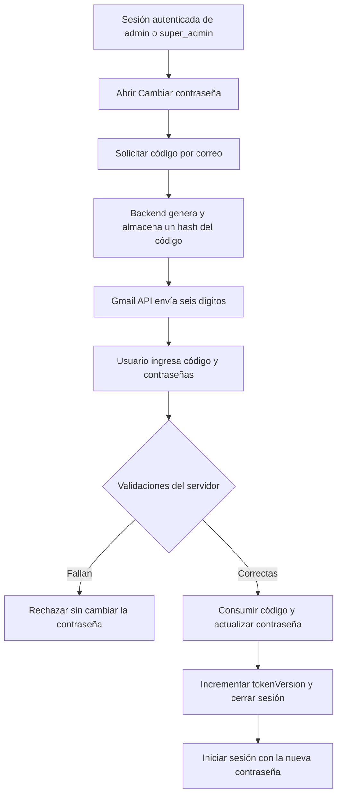

# Iglesia El Ancla ⚓ — Integración de Gmail y seguridad de cuentas

> **Documento técnico de desarrollo** · PWA Iglesia El Ancla Comunidad Cristiana  
> **Estado:** integración y pruebas funcionales de desarrollo completadas para Gmail y cambio de contraseña de `super_admin`  
> **Fecha de documentación:** octubre de 2026  
> **Alcance:** autenticación existente, conexión OAuth con Gmail API, envío institucional, código temporal para cambio de contraseña, pruebas realizadas y limpieza de la arquitectura.

---

## 1. Propósito de este documento

Registrar las decisiones, implementaciones y pruebas realizadas en el proyecto **Iglesia El Ancla**, para que el equipo pueda comprender, mantener y continuar el desarrollo del módulo de correo institucional y seguridad de cuentas.

El módulo persigue dos objetivos principales:

1. **Enviar correos desde la dirección institucional mediante Gmail API**, sin almacenar contraseñas de Google ni dar acceso a la bandeja de entrada.
2. **Proteger el cambio voluntario de contraseña** mediante la combinación de sesión autenticada, contraseña actual y un código de seis dígitos remitido al correo registrado.

El desarrollo también dejó una decisión de arquitectura: **la activación futura de usuarios por invitación confirmará la posesión del correo** mediante un enlace seguro. Por ello, el prototipo separado de `/verificar-correo` se retiró después de completar el cambio seguro de contraseña.

**Esta documentación describe la implementación para desarrollo. No representa una certificación de seguridad ni un despliegue listo para producción.**

## 2. Tecnologías utilizadas

| Área | Tecnología | Utilización |
|---|---|---|
| Interfaz | React, React Router, CSS modular | Formularios y navegación por rol |
| API | Node.js, Express | Rutas de autenticación, seguridad y envío |
| Persistencia | MongoDB Atlas, Mongoose | Usuarios, desafíos temporales y conexión de Gmail |
| Sesiones | JWT, cookies HttpOnly | Identificar a la cuenta autenticada |
| Contraseñas | bcryptjs | Comparación y hash de contraseñas |
| Correo | Gmail API, `googleapis` | Envío de mensajes institucionales |
| Composición de mensajes | `nodemailer` / MailComposer | Construcción MIME de texto y HTML |
| Autorización de Google | OAuth 2.0 | Conexión autorizada de la cuenta remitente |
| Cifrado | Node.js `crypto`, AES-256-GCM | Protección del *refresh token* almacenado |
| Protección de códigos | HMAC-SHA256 | Guardar un verificador, no el OTP original |
| Restricción de tráfico | `express-rate-limit` | Límites por IP de solicitudes e intentos |

## 3. Resumen de lo realizado

### 3.1. Base de autenticación y seguridad existente

Se revisó y reutilizó la infraestructura de autenticación compartida para los roles `member`, `admin` y `super_admin`:

- `POST /api/auth/login`: validación de credenciales y emisión de cookie de sesión.
- `GET /api/auth/me`: consulta de usuario autenticado y datos de sesión.
- `POST /api/auth/logout`: cierre de sesión mediante eliminación de cookie.
- `authenticateUser.js`: verifica JWT, usuario activo, `tokenVersion` y sucursales habilitadas.
- `authorizeRoles.js`: restringe operaciones según el rol almacenado en el servidor.
- Bloqueo de cuenta después de cinco intentos fallidos, temporalmente durante quince minutos.
- Políticas de sesión consultables en el panel de configuración del superadministrador.
- Cambio de contraseña preexistente con contraseña actual, política de complejidad, espera de 24 horas e invalidación de sesiones.

**Problema detectado:** la versión original de `POST /api/auth/change-password` permitía cambiar la contraseña conociendo solo la contraseña actual, sin verificar acceso al correo registrado.

### 3.2. Gmail API y OAuth 2.0

Se configuró el proyecto de Google Cloud para utilizar Gmail API y autorizar una cuenta institucional de envío.

Se implementaron:

- Un cliente OAuth 2.0 configurado exclusivamente en el backend.
- Una ruta para iniciar la conexión de Google, accesible solo a `super_admin`.
- Un *callback* que valida el parámetro `state`, la identidad del remitente y los permisos otorgados.
- Obtención y almacenamiento del *refresh token* de Google **cifrado** en MongoDB Atlas.
- Envío de mensajes de texto y HTML mediante la API de Gmail, sin exponer credenciales a React.

**Permisos utilizados:**

- `https://www.googleapis.com/auth/gmail.send` — envío de correos.
- `openid` y `email` — comprobación de identidad de la cuenta Google en el proceso OAuth.

**No se solicitaron permisos de lectura de correos.**

### 3.3. Servicio de correo institucional

Se creó una función central para evitar implementar el envío de correos por separado en cada módulo:

```js
sendInstitutionalEmail({
  to,
  subject,
  text,
  html,
});
```

El servicio:

1. Valida remitente y destinatario.
2. Recupera el *refresh token* cifrado desde MongoDB y lo descifra en el backend.
3. Construye el mensaje MIME con MailComposer.
4. Realiza el envío mediante `gmail.users.messages.send`.
5. Devuelve un identificador de mensaje, **no credenciales**.

Se utilizó también un script de prueba desde la terminal para verificar el envío antes de conectarlo con formularios React.

### 3.4. Primer prototipo de verificación de correo

Se construyó y probó un flujo separado para verificar la dirección de correo de una cuenta:

- Generación de un código numérico de seis dígitos.
- Envío por Gmail.
- Almacenamiento del hash y fecha de vencimiento.
- Confirmación del código y actualización de `User.emailVerifiedAt`.
- Página React `/verificar-correo`.

En las pruebas, el envío, la confirmación y el rechazo de un código reutilizado respondieron correctamente. También se corrigió una URL mal compuesta (`/api/api/auth/me`) y se incorporó `emailVerifiedAt` a las respuestas de `/login` y `/me`.

**Decisión posterior:** se retiró la verificación de correo independiente para evitar un paso redundante en el futuro registro por invitación. **No se eliminó el modelo de códigos**, porque ahora se reutiliza para cambios de contraseña. La implementación histórica no debe confundirse con un módulo actualmente habilitado.

### 3.5. Cambio de contraseña protegido con código (OTP)

Se modificó el cambio de contraseña para que el backend exija, conjuntamente:

- Sesión JWT vigente de un `super_admin` o `admin`.
- Correo registrado marcado como verificado.
- Código de seis dígitos enviado a ese correo.
- Contraseña actual correcta.
- Contraseña nueva que cumpla la política definida en `passwordUtils.js`.

Se reutilizó el modelo existente `EmailVerificationCode.js`, con `purpose: "password_change"`. **No se agregó una colección de autorización separada**.

### 3.6. Limpieza posterior

Tras probar exitosamente el cambio de contraseña, se decidió mantener cinco modelos y retirar componentes del mecanismo anterior:

- Se retiró `branchAccessCheckRoutes.js`, utilizado como ruta temporal de prueba.
- Se retiró `emailVerificationRoutes.js` y su registro en `app.js`.
- Se retiraron `emailVerificationService.js` y `emailVerificationMailService.js`.
- Se retiró la antigua página `VerifyEmail.jsx`, su CSS y la ruta `/verificar-correo`.
- Se descartó `PasswordChangeAuthorization.js`: el cambio de contraseña valida y consume el mismo código almacenado en `EmailVerificationCode.js`.

La limpieza fue seguida por una nueva prueba del cambio de contraseña, que el equipo informó como **correctamente funcional**.

---

## 4. Arquitectura final de los archivos involucrados

Los siguientes árboles muestran **solo los archivos relevantes** a esta documentación; el proyecto contiene otros componentes y módulos.

### 4.1. Backend

```text
backend/
├── package.json
├── server.js
└── src/
    ├── app.js
    ├── config/
    │   ├── database.js
    │   └── loginSecurityPolicy.js
    ├── middleware/
    │   ├── .env                         # LOCAL, PRIVADO, NO SUBIR A GIT
    │   ├── authenticateUser.js
    │   └── authorizeRoles.js
    ├── models/
    │   ├── EmailVerificationCode.js    # Códigos temporales
    │   ├── GoogleMailConnection.js     # Autorización Gmail cifrada
    │   ├── Sucursal.js
    │   ├── SystemSettings.js
    │   └── User.js                     # member, admin, super_admin
    ├── routes/
    │   ├── administratorProtectionRoutes.js
    │   ├── googleOAuthRoutes.js
    │   ├── loginRoutes.js
    │   ├── loginSecurityPolicyRoutes.js
    │   ├── passwordRoutes.js
    │   ├── sessionPolicyRoutes.js
    │   ├── sucursalRoutes.js
    │   ├── systemSettingsRoutes.js
    │   └── userRoutes.js
    ├── services/
    │   └── mail/
    │       ├── gmailService.js
    │       ├── googleMailConnectionService.js
    │       ├── googleOAuthClient.js
    │       ├── googleTokenEncryption.js
    │       └── passwordChangeVerificationService.js
    ├── scripts/
    │   ├── createInitialAdmin.js
    │   └── testInstitutionalEmail.js
    └── utils/
        ├── passwordUtils.js
        └── tokenUtils.js
```

### 4.2. Frontend

```text
frontend/src/
├── App.js
├── components/
│   ├── auth/
│   │   └── ChangePasswordForm.jsx
│   └── super-admin/
│       └── settings/
│           └── SecuritySettings.jsx
├── pages/
│   └── auth/
│       └── ChangePassword.jsx
├── services/
│   └── api.js
└── styles/
    └── components/
        └── auth/
            └── ChangePasswordForm.css
```

La página `/cambiar-contrasena` ya existía y se mantuvo. La interfaz fue modificada para solicitar primero el código y después permitir ingresar las contraseñas; se conservó el estilo visual de la plataforma.

---

## 5. Configuración utilizada en Google Cloud (desarrollo)

### 5.1. Preparación

Se configuró un proyecto en Google Cloud para la aplicación Iglesia El Ancla y se habilitó **Gmail API**. También se configuró una aplicación OAuth con cliente de tipo **aplicación web**.

Durante el desarrollo se utilizó la modalidad de pruebas de la pantalla de consentimiento y se autorizó la cuenta remitente institucional como usuario de prueba cuando correspondía.

El *redirect URI* configurado en Google debe coincidir exactamente con el valor del backend. Ejemplo de desarrollo:

```text
http://localhost:5000/api/auth/google/callback
```

No es suficiente registrar solo el dominio: debe coincidir el esquema, puerto y ruta de retorno.

### 5.2. Flujo de conexión

1. Iniciar sesión en la PWA con una cuenta `super_admin`.
2. Solicitar en el backend `POST /api/auth/google/connect` con un cuerpo JSON válido y la cookie de sesión.
3. El backend genera un valor aleatorio `state` y una URL de autorización.
4. El navegador abre la URL de Google y se autoriza la cuenta institucional.
5. Google redirige a `GET /api/auth/google/callback`.
6. El backend comprueba `state`, identidad del correo autorizado y permiso `gmail.send`.
7. Guarda el *refresh token* cifrado en MongoDB Atlas.
8. El servicio central queda habilitado para realizar envíos desde la cuenta conectada.

El inicio de conexión está restringido al superadministrador. El navegador **no recibe el refresh token**.

### 5.3. Datos persistidos

Colección: **`google_mail_connections`**.

El modelo `GoogleMailConnection.js` contiene, entre otros:

| Campo | Descripción |
|---|---|
| `connectionKey` | Identificador único `institutional-gmail` |
| `senderEmail` | Dirección institucional autorizada |
| `encryptedRefreshToken` | Refresh token cifrado, no expuesto por defecto |
| `encryptionIv` | Vector de inicialización del cifrado |
| `encryptionAuthTag` | Etiqueta de autenticación AES-GCM |
| `scopes` | Permisos guardados de la autorización |
| `authorizedAt` | Fecha de autorización o reconexión |
| `isActive` | Permite desactivar el servicio sin borrar la conexión |

El cifrado utiliza **AES-256-GCM** y una clave de 32 bytes configurada como variable de entorno. Nunca se almacena el token original en texto plano dentro de esa colección.

---

## 6. Variables de entorno requeridas

**Ubicación acordada en el proyecto:** `backend/src/middleware/.env`.

El proyecto ejecuta Node con `--env-file=./src/middleware/.env` desde `backend/`. Los nombres siguientes se documentan **sin valores secretos**.

```dotenv
# Servidor y conexión a base de datos
PORT=5000
NODE_ENV=development
MONGODB_URI=<cadena-de-conexion-de-mongodb-atlas>
FRONTEND_URL=http://localhost:3000

# Autenticación
JWT_SECRET=<secreto-aleatorio-de-al-menos-64-bytes>
JWT_EXPIRES_IN=4h

# Cliente OAuth (proporcionado por Google Cloud)
GOOGLE_CLIENT_ID=<id-del-cliente-oauth>
GOOGLE_CLIENT_SECRET=<secreto-del-cliente-oauth>
GOOGLE_REDIRECT_URI=http://localhost:5000/api/auth/google/callback
GMAIL_SENDER_EMAIL=<correo-institucional-autorizado>

# Protección de secretos y códigos
GOOGLE_TOKEN_ENCRYPTION_KEY=<clave-aleatoria-de-32-bytes-en-base64>
EMAIL_VERIFICATION_HMAC_KEY=<otra-clave-aleatoria-de-32-bytes-en-base64>
```

**Aclaraciones:**

- `JWT_EXPIRES_IN=4h` corresponde a la duración mostrada en el panel durante las pruebas. El servidor lee el valor efectivo desde la configuración; debe verificarse en cada entorno.
- `GOOGLE_TOKEN_ENCRYPTION_KEY` y `EMAIL_VERIFICATION_HMAC_KEY` tienen **finalidades diferentes** y deben ser independientes.
- Los valores entre `<...>` son **marcadores de posición**, no credenciales utilizables.
- Los archivos `.env`, las contraseñas, las capturas de códigos y los tokens **no deben incorporarse a GitHub**.
- La ruta de `.env` es específica de este proyecto. No debe moverse arbitrariamente porque los scripts de arranque la utilizan.

### 6.1. Ejemplo para ignorar secretos en Git

Agregar una regla como esta al `.gitignore` de la raíz, si todavía no existe:

```gitignore
# Entorno privado del backend
backend/src/middleware/.env

# Archivos de entorno locales adicionales
**/.env.local
**/.env.*.local
```

Revisar que el archivo no estuviera previamente versionado. Un `.gitignore` no elimina secretos ya publicados en el historial: si se expusieron, deben revocarse y regenerarse.

---

## 7. Inicio y comprobación del entorno de desarrollo

### 7.1. Backend

Desde la carpeta `backend/`:

```bash
npm install
npm run dev
```

O con el script habitual:

```bash
npm start
```

El `package.json` del backend contiene:

```json
{
  "scripts": {
    "start": "node --env-file=./src/middleware/.env server.js",
    "dev": "nodemon --exec \"node --env-file=./src/middleware/.env\" server.js"
  }
}
```

Comprobar que MongoDB Atlas se conecta y que la API responde:

```text
GET http://localhost:5000/api/status
```

Resultado esperado: estado HTTP `200` y propiedad `status: "online"`.

### 7.2. Frontend

Iniciar la aplicación React usando el script de desarrollo configurado en `frontend/package.json` (en este proyecto se utiliza habitualmente `npm start`).

La interfaz de desarrollo se abre en:

```text
http://localhost:3000
```

Verificar la configuración de `frontend/src/services/api.js`: **la URL base no debe duplicar `/api`**. Durante la integración se corrigió un problema de esta clase que producía solicitudes a `/api/api/auth/me`.

### 7.3. Envío de correo de prueba

Desde `backend/`:

```bash
node --env-file=./src/middleware/.env src/scripts/testInstitutionalEmail.js "destinatario-de-prueba@ejemplo.com"
```

Se debe utilizar una casilla de prueba controlada por el equipo. El script se conecta a MongoDB Atlas y realiza un envío real mediante Gmail API.

**Resultado comprobado en desarrollo:** Gmail aceptó el mensaje de prueba y se constató la recepción en una casilla de prueba.

---

## 8. Flujo final: cambio de contraseña con código de seis dígitos

### 8.1. Secuencia de usuario



La pantalla React solo organiza la experiencia. **La autorización del cambio reside íntegramente en el backend.**

### 8.2. Endpoint para solicitar código

```http
POST /api/auth/change-password/request-code
Content-Type: application/json
```

Cuerpo:

```json
{}
```

Requiere:

- Cookie JWT válida (HttpOnly).
- Rol `admin` o `super_admin`.
- `Origin` coincidente con el frontend configurado.
- Cuenta activa y dirección de correo verificada.

Respuesta exitosa representativa (sin reproducir valores reales):

```json
{
  "success": true,
  "message": "Enviamos un código al correo registrado de tu cuenta",
  "expiresAt": "<fecha-ISO>",
  "resendAfterSeconds": 60
}
```

**El código no se devuelve en la respuesta.** Solo se envía al correo registrado en el usuario autenticado.

### 8.3. Endpoint para efectuar el cambio

```http
POST /api/auth/change-password
Content-Type: application/json
```

Cuerpo:

```json
{
  "code": "123456",
  "currentPassword": "<contraseña-actual>",
  "newPassword": "<contraseña-nueva>"
}
```

Los valores son ilustrativos. **No se deben guardar contraseñas ni códigos reales en la documentación, en logs o en capturas públicas.**

El backend rechaza solicitudes que omitan uno de los tres campos, reciban tipos incorrectos o incluyan campos adicionales.

Respuesta exitosa representativa:

```json
{
  "success": true,
  "message": "Contraseña actualizada. Inicia sesión nuevamente",
  "requiresLogin": true,
  "nextAllowedAt": "<fecha-ISO>"
}
```

Después del cambio, las sesiones anteriores dejan de ser válidas y se requiere iniciar sesión con la nueva contraseña.

### 8.4. Condiciones verificadas por el backend

1. Sesión vigente y rol autorizado.
2. Solicitud proveniente del origen configurado.
3. Cuenta activa, correo registrado y `emailVerifiedAt` informado.
4. Contraseña actual correcta.
5. Contraseña nueva distinta de la anterior y válida según `passwordUtils.js`.
6. Período de espera entre cambios voluntarios.
7. Código correspondiente a la cuenta, el correo, la sesión actual y el propósito `password_change`.
8. Código no vencido, no consumido y con intentos disponibles.
9. Consumo del código y actualización de contraseña dentro de una transacción de MongoDB.
10. Incremento de `tokenVersion`, invalidando cookies JWT emitidas anteriormente.

**La validación no puede omitirse navegando directamente a `/cambiar-contrasena` ni llamando al endpoint de API.**

---

## 9. Políticas de seguridad implementadas

| Control | Política implementada |
|---|---|
| Código OTP | Seis dígitos aleatorios mediante `crypto.randomInt` |
| Validez del código | Diez minutos |
| Intentos incorrectos | Cinco por desafío |
| Reenvío | Intervalo mínimo de sesenta segundos |
| Solicitud de código | Limitador por IP: cinco solicitudes cada quince minutos |
| Cambio de contraseña | Limitador por IP: cinco solicitudes cada quince minutos |
| Roles habilitados | `super_admin` y `admin` |
| Protección del código almacenado | HMAC-SHA256; no se guarda el valor legible |
| Comparación de hashes | Comparación en tiempo constante |
| Asociación del desafío | Propósito, usuario, correo y token de sesión |
| Uso del código | Único, consumido con el cambio de contraseña |
| Nueva contraseña | Mínimo doce caracteres y reglas adicionales de `passwordUtils.js`; máximo setenta y dos bytes UTF-8 para bcrypt |
| Cambios repetidos | Espera de veinticuatro horas entre cambios voluntarios |
| Sesiones existentes | Se invalidan mediante incremento de `tokenVersion` |
| CSRF | Comprobación del encabezado `Origin`, como defensa complementaria |

**Límite importante:** la comprobación de `Origin` es una medida complementaria y no sustituye una revisión completa de CSRF para el despliegue en producción.

### 9.1. Persistencia del desafío

Colección reutilizada: **`email_verification_codes`**. El nombre histórico de la colección se conserva para evitar una migración innecesaria.

El modelo `EmailVerificationCode.js` contiene:

- `user`: identificador de la cuenta.
- `purpose`: operación a la que corresponde el código; el flujo actual utiliza `password_change`.
- `email`: destinatario normalizado.
- `codeHash`: HMAC del código, oculto en las consultas habituales.
- `expiresAt`: fecha de vencimiento.
- `attempts` y `maxAttempts`: control de intentos.
- `lastSentAt`: control de reenvíos.
- `consumedAt`: fecha de consumo, o `null` mientras siga disponible.

Índices relevantes:

```js
{ user: 1, purpose: 1 } // único por usuario y operación
{ expiresAt: 1 }        // índice TTL
```

La eliminación por TTL es asíncrona; **el backend revisa `expiresAt` en cada validación**. No se necesita una colección adicional de autorizaciones.

### 9.2. Transacción del cambio de contraseña

La función `passwordChangeVerificationService.js` comprueba el código y registra intentos incorrectos mediante operaciones controladas. En el cambio definitivo, el backend utiliza una transacción para:

1. Marcar el desafío como consumido.
2. Actualizar `User.passwordHash` y `User.passwordChangedAt`.
3. Poner `mustChangePassword` en `false` cuando corresponde.
4. Incrementar `User.tokenVersion`.

Si falla la transacción, el cambio completo se revierte. El hash bcrypt de la contraseña nueva se calcula previamente para acortar la duración de la transacción.

---

## 10. Modelo de usuarios y estados relacionados

El modelo **`User.js`** sigue siendo único para `member`, `admin` y `super_admin`.

Campos de seguridad especialmente relevantes:

| Campo | Uso |
|---|---|
| `passwordHash` | Hash de la contraseña, no expuesto por defecto |
| `emailVerifiedAt` | Fecha en que se confirmó la dirección de correo |
| `mustChangePassword` | Señala que una contraseña temporal debe reemplazarse |
| `passwordChangedAt` | Base para la espera entre cambios |
| `tokenVersion` | Revocación de sesiones existentes |
| `loginAttempts` | Registro de intentos fallidos de inicio de sesión |
| `lockUntil` | Fecha límite de bloqueo temporal de acceso |
| `role` | `member`, `admin` o `super_admin` |
| `isActive` | Habilitación de la cuenta |

**Importante para el futuro:** el cambio de contraseña con OTP documentado aquí funciona actualmente con `admin` y `super_admin`. No se debe asumir que el mismo flujo está habilitado para `member` hasta agregarlo y probarlo.

## 11. Pruebas y evidencias

Distinguir entre pruebas realmente realizadas y casos que quedaron recomendados.

### 11.1. Pruebas completadas e informadas

| Prueba | Resultado documentado |
|---|---|
| Autorización OAuth 2.0 con la cuenta de Google institucional | Correcta |
| Almacenamiento cifrado de la conexión en MongoDB Atlas | Correcto durante la integración |
| Envío de correo de prueba por Gmail API | Correcto; recepción comprobada |
| Primer flujo de verificación de correo (prototipo posteriormente retirado) | Envío, confirmación y rechazo de reutilización comprobados |
| Corrección de URL `/api/api/auth/me` | Corregida |
| Consulta del estado `emailVerifiedAt` desde `/api/auth/me` | Corregida |
| Solicitud del OTP de cambio de contraseña | El correo llegó correctamente |
| Cambio de contraseña de `super_admin` con OTP, contraseña actual y nueva | Correcto |
| Inicio de sesión con la nueva contraseña | Correcto |
| Funcionamiento del cambio tras eliminar archivos antiguos | Confirmado por el equipo |

**La comprobación de extremo a extremo realizada y reportada corresponde a una cuenta `super_admin`.** El código permite `admin`, pero se recomienda documentar una prueba específica con ese rol antes de afirmar cobertura completa.

### 11.2. Casos recomendados de regresión

- [ ] Solicitar cambio sin sesión: debe rechazarse.
- [ ] Solicitar cambio desde un rol no autorizado: debe rechazarse.
- [ ] Solicitar código y comprobar que el cuerpo de respuesta no lo contenga.
- [ ] Enviar `POST /api/auth/change-password` sin `code`: debe rechazarse.
- [ ] Probar código incorrecto y agotamiento de cinco intentos.
- [ ] Probar código vencido tras diez minutos.
- [ ] Probar reutilización del código después de un cambio exitoso.
- [ ] Probar solicitud desde otra sesión de la misma cuenta: el código original no debe autorizarla.
- [ ] Probar reenvío antes y después de sesenta segundos.
- [ ] Probar contraseña actual incorrecta.
- [ ] Probar nueva contraseña que no cumpla la política.
- [ ] Probar la restricción de veinticuatro horas entre cambios voluntarios.
- [ ] Confirmar que las sesiones previas dejan de ser válidas.
- [ ] Ejecutar una prueba completa con `admin`.
- [ ] Revisar el proceso de contraseña temporal (`mustChangePassword`) separado de los cambios voluntarios.

Esta lista no implica que las pruebas pendientes hayan fallado; indica que **no consta aquí evidencia de su ejecución**.

---

## 12. Archivos y funcionalidades que se descartaron

Para evitar duplicaciones se decidió **no mantener**:

```text
backend/src/models/PasswordChangeAuthorization.js
backend/src/routes/branchAccessCheckRoutes.js
backend/src/routes/emailVerificationRoutes.js
backend/src/services/mail/emailVerificationService.js
backend/src/services/mail/emailVerificationMailService.js
frontend/src/pages/auth/VerifyEmail.jsx
frontend/src/styles/pages/auth/VerifyEmail.css
```

También se retiraron del registro de rutas las referencias a la página y al endpoint antiguo de verificación de correo.

**Se mantienen expresamente:**

- `EmailVerificationCode.js` y su colección en MongoDB, porque el cambio de contraseña lo utiliza.
- `emailVerifiedAt` en `User.js`, necesario para distinguir correos verificados.
- Los cinco servicios actuales de `services/mail/`.
- Las rutas de login, contraseñas, OAuth y políticas de seguridad.

Los archivos eliminados de Git y los documentos existentes en MongoDB son asuntos diferentes. **Eliminar un archivo JS no elimina automáticamente una colección o un índice**, y la colección `email_verification_codes` no debe borrarse.

---

## 13. Diagnóstico de problemas comunes

| Síntoma | Qué revisar |
|---|---|
| La API no inicia | Variables requeridas, conexión de MongoDB y logs del backend |
| Error 404 con `/api/api/...` | URL base del frontend: evitar agregar dos veces el prefijo `/api` |
| No llega el código | Conexión Gmail activa, remitente autorizado, bandeja de spam, errores de Gmail API |
| Se rechaza la solicitud de código | JWT/cookie vigente, rol permitido, `Origin`, `emailVerifiedAt` y limitadores |
| El servidor responde 429 | Espera mínima de reenvío, límite de intentos o restricción de 24 horas |
| Código incorrecto aunque se copió bien | Código sustituido por otro envío, vencimiento, otra sesión o agotamiento de intentos |
| Gmail deja de enviar después de varios días | Revisar la autorización OAuth, su estado de pruebas y eventual expiración/revocación del refresh token |
| El cambio funcionó, pero se cerró la sesión | Comportamiento esperado: se invalidan sesiones y se solicita nuevo login |
| `admin` no puede cambiar su contraseña | Verificar rol, correo verificado, sesión y prueba específica con esa cuenta |
| Cambio inicial de contraseña temporal | Revisar el flujo `mustChangePassword`, que tiene condiciones de uso distintas |

No imprimir tokens, códigos, contraseñas ni objetos completos con credenciales durante el diagnóstico.

## 14. Estado actual y trabajos pendientes

### 14.1. Completado para desarrollo

- [x] Cliente OAuth 2.0 del backend.
- [x] Habilitación y autorización de Gmail API.
- [x] Comprobación de identidad y permisos de la cuenta remitente.
- [x] Cifrado AES-256-GCM del refresh token en MongoDB Atlas.
- [x] Servicio común de envío institucional.
- [x] Script de prueba de envío y recepción.
- [x] Modelo reutilizado para códigos temporales.
- [x] Cambio voluntario de contraseña protegido con OTP para roles administrativos en el código.
- [x] Prueba integral exitosa con `super_admin`.
- [x] Retiro del flujo separado de verificación de correo y limpieza del backend/frontend.

### 14.2. Pendiente o fuera del alcance

- [ ] Registrar y activar nuevos miembros mediante **invitación segura por correo**.
- [ ] Marcar `emailVerifiedAt` al completar satisfactoriamente una invitación válida y de un solo uso.
- [ ] Definir y probar el primer establecimiento de contraseña y las excepciones `mustChangePassword`.
- [ ] Habilitar y probar, si se decide, el cambio voluntario de contraseña para `member`.
- [ ] Implementar recuperación de acceso para usuarios que olvidaron la contraseña.
- [ ] Completar la matriz de pruebas negativas y prueba real con `admin`.
- [ ] Revisar controles CSRF para producción, monitoreo y registros seguros.
- [ ] Preparar autorización OAuth de producción, HTTPS, dominio y política de despliegue.
- [ ] Revisar si Google exige publicación/verificación OAuth y comprobar la vigencia de los tokens antes del lanzamiento.

**Consideración de Gmail en desarrollo:** cuando una aplicación OAuth externa está en estado *Testing*, ciertos refresh tokens pueden tener una duración limitada, frecuentemente de siete días para ámbitos que no sean solo identidad básica. Si dejan de funcionar, primero revisar las condiciones del proyecto Google y reconectar cuando corresponda; no desactivar controles de seguridad como solución.

### 14.3. Futuro registro por invitación

El proceso acordado conceptualmente es:

1. Un administrador autorizado registra la cuenta y el correo del nuevo miembro.
2. Se envía **un solo mensaje de invitación** con enlace de un solo uso y caducidad.
3. El destinatario abre el enlace y establece su contraseña.
4. El backend valida el token de invitación y registra `emailVerifiedAt`.
5. La cuenta queda habilitada conforme a sus permisos.

**Este flujo aún no se implementó en la etapa documentada.** Requiere diseñar la emisión, persistencia y consumo seguro de invitaciones, además de revisar cómo se crea `User.passwordHash` antes de que la persona elija su contraseña.

---

## 15. Recomendaciones para mantener la arquitectura limpia

- Conservar un solo modelo `User` para los tres roles.
- Mantener **un servicio central de correo**, separado de los flujos que lo invocan.
- Guardar los desafíos de contraseña en la colección existente `email_verification_codes` con su propósito específico.
- No agregar nuevas colecciones para autorizaciones efímeras cuando el cambio puede validarse y consumirse de forma segura con el modelo actual.
- No reutilizar códigos de una operación para otra; `purpose` forma parte de la validación criptográfica.
- Mantener las validaciones de seguridad en el backend, no solo en React.
- Evitar archivos «temporales de prueba» registrados en el servidor de producción.
- Tras cada limpieza, revisar importaciones de `app.js`, rutas de `App.js`, dependencias de servicios y pruebas de regresión.
- Guardar este README en el repositorio, **pero nunca sus secretos, tokens ni datos personales reales**.

## 16. Referencia rápida de endpoints

| Método | Ruta | Función |
|---|---|---|
| `GET` | `/api/status` | Comprobar disponibilidad de API |
| `POST` | `/api/auth/login` | Iniciar sesión |
| `GET` | `/api/auth/me` | Consultar usuario autenticado |
| `POST` | `/api/auth/logout` | Cerrar sesión |
| `POST` | `/api/auth/google/connect` | Iniciar autorización de la cuenta Gmail institucional; solo superadministrador |
| `GET` | `/api/auth/google/callback` | Completar autorización OAuth de Google |
| `POST` | `/api/auth/change-password/request-code` | Enviar OTP para cambio de contraseña |
| `POST` | `/api/auth/change-password` | Cambiar contraseña con OTP y contraseña actual |

**Ruta web asociada:** `http://localhost:3000/cambiar-contrasena`.

El antiguo endpoint `/api/auth/email-verification/...` y la antigua página `/verificar-correo` **no forman parte del flujo final** después de la limpieza descrita.

---

## 17. Cierre de la etapa

La integración de Gmail API y el cambio seguro de contraseña representan una etapa de desarrollo completada y funcionalmente comprobada para la cuenta `super_admin`.

El resultado más importante es que **conocer la contraseña actual ya no basta para modificarla**: la operación requiere adicionalmente un código recibido en el correo asociado a la sesión y validado por el backend. Al completar el cambio se consume el código, se actualiza el hash de la contraseña y se revocan las sesiones anteriores.

La arquitectura final mantiene **cinco modelos**, **nueve archivos de rutas principales** y **cinco servicios de correo** dentro del alcance revisado, sin añadir una colección independiente para autorizar cambios de contraseña.

**Siguiente fase sugerida:** activar cuentas mediante invitación y establecer el flujo de contraseñas iniciales, manteniendo separados los procesos de registro, recuperación de acceso y cambio voluntario de contraseña.

---

*Documento elaborado a partir de los archivos del proyecto revisados durante la integración y de las pruebas de desarrollo informadas en la conversación. Revisar este README cuando cambien las rutas, políticas, despliegue o arquitectura.*
