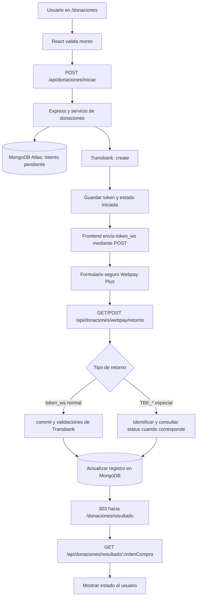

# Módulo de donaciones — Webpay Plus | Iglesia El Ancla ⚓

**Proyecto:** Diseño e implementación de una PWA para la digitalización de la gestión de información y servicios de la Iglesia El Ancla  
**Componente:** Aportes voluntarios mediante Transbank Webpay Plus  
**Versión documentada:** Prototipo funcional en ambiente de integración  
**Fecha de documentación:** 25 de octubre de 2026  
**Estado:** Funcional y probado en desarrollo; **no habilitado para cobros reales**.

---

## 1. Descripción general

Se implementó un módulo de aportes voluntarios dentro de la aplicación web progresiva (PWA) de Iglesia El Ancla. El módulo permite que un visitante, miembro registrado o administrador inicie un aporte en pesos chilenos, sea redirigido al formulario alojado por Transbank y consulte posteriormente el resultado de su operación.

La solución registra cada intento de aporte en **MongoDB Atlas** y utiliza el SDK oficial de **Transbank Webpay Plus** desde el backend. El frontend nunca recibe ni procesa directamente los datos de la tarjeta: estos se ingresan en la interfaz de Transbank.

Durante el desarrollo se incorporaron validación de montos, control de estados, retornos de pago aprobado/rechazado, cancelación voluntaria, expiración del formulario, auditoría, conciliación manual, un trabajador de conciliación local y pruebas automatizadas.

> **Alcance:** esta documentación describe lo implementado y verificado **en el ambiente de integración de Transbank**. No constituye una certificación de seguridad, habilitación comercial ni autorización para recibir dinero real.

### Objetivos del módulo

- Centralizar el inicio y seguimiento de aportes voluntarios desde la PWA.
- Conservar referencias y estados para trazabilidad operativa.
- Evitar contabilizar como ingresos operaciones que no hayan sido confirmadas.
- Distinguir resultados financieros definitivos de resultados todavía inciertos.
- Ofrecer una base técnica reutilizable para el futuro panel administrativo financiero.

### Alcance funcional de esta versión

- **Aportes únicos**: se descartaron los aportes recurrentes o mensuales en esta etapa.
- Montos sugeridos: **$5.000, $10.000, $20.000 y $50.000 CLP**.
- Monto personalizado permitido: **desde $1.000 hasta $5.000.000 CLP**, en pesos enteros.
- Inicio de pago desde la ruta pública `/donaciones`.
- Consulta del resultado desde `/donaciones/resultado?orden=<ordenCompra>`.
- Operaciones de integración; el módulo no procesa cobros comerciales en producción.

---

## 2. Tecnologías y dependencias

| Capa | Tecnología | Función |
| --- | --- | --- |
| Frontend | React y React Router | Formularios, navegación y visualización del resultado |
| Estilos | CSS del proyecto | Interfaz alineada con la identidad visual de El Ancla |
| Backend | Node.js, Express (módulos ES) | API, validaciones y control de retornos |
| Base de datos | MongoDB Atlas + Mongoose | Persistencia de intentos de aporte y estados |
| Pasarela | Transbank Webpay Plus | Inicio, confirmación y consulta de transacciones |
| SDK | `transbank-sdk` (se utilizó la versión 6.1.1) | Comunicación con la API de Transbank |
| Seguridad HTTP | Helmet, CORS, `express-rate-limit` | Encabezados de protección, origen permitido y límites de uso |
| Registro HTTP | Morgan | Trazas de solicitudes sin parámetros sensibles en la URL |
| Pruebas | `node:test` y `node:assert/strict` | Pruebas unitarias y simulaciones de procesamiento |

> La versión del SDK corresponde a la utilizada durante la implementación. Consultar `backend/package.json` y `package-lock.json` para conocer la versión efectivamente fijada en el repositorio.

---

## 3. Organización de archivos

La organización documentada al finalizar las pruebas es la siguiente (se muestran los archivos relacionados con Webpay, no todo el proyecto):

```text
iglesia-el-ancla/
├── backend/
│   ├── server.js
│   ├── package.json
│   ├── src/
│   │   ├── app.js
│   │   ├── config/
│   │   │   └── database.js
│   │   ├── middleware/
│   │   │   └── .env                  # LOCAL; nunca subir a Git
│   │   ├── models/
│   │   │   └── Donacion.js
│   │   ├── routes/
│   │   │   └── donacionRoutes.js
│   │   ├── services/
│   │   │   └── webpay/
│   │   │       ├── webpay.js
│   │   │       ├── donacionService.js
│   │   │       ├── conciliacionService.js
│   │   │       └── procesamientoConciliacionService.js
│   │   └── scripts/
│   │       └── webpay/
│   │           ├── diagnosticarWebpay.js
│   │           ├── auditarDonacionesPendientes.js
│   │           ├── conciliarDonacionesPendientes.js
│   │           └── conciliacionAutomatica.js
│   └── tests/
│       └── webpay/
│           ├── conciliacion.test.js
│           └── procesamientoConciliacion.test.js
└── frontend/
    └── src/
        ├── pages/
        │   └── public/
        │       ├── Donaciones.jsx
        │       └── DonacionResultado.jsx
        └── styles/
            └── pages/
                └── public/
                    ├── Donaciones.css
                    └── DonacionResultado.css
```

### Responsabilidades principales

| Archivo | Responsabilidad |
| --- | --- |
| `Donaciones.jsx` | Selección y validación de monto; solicitud de inicio; envío del token a Webpay mediante formulario POST |
| `DonacionResultado.jsx` | Consulta del estado al backend y presentación del resultado |
| `Donacion.js` | Esquema de persistencia y estados de las operaciones |
| `webpay.js` | Creación del cliente del SDK para el ambiente configurado |
| `donacionService.js` | Inicio de transacciones, confirmación y manejo de retornos especiales |
| `donacionRoutes.js` | Endpoints públicos y redirección a la página de resultados |
| `conciliacionService.js` | Reglas puras para determinar el estado propuesto |
| `procesamientoConciliacionService.js` | Consulta `status()`, valida datos y aplica actualizaciones condicionales |
| `conciliarDonacionesPendientes.js` | Ejecución manual, con simulación predeterminada y opción `--aplicar` |
| `auditarDonacionesPendientes.js` | Auditoría de solo lectura |
| `diagnosticarWebpay.js` | Diagnóstico puntual de la operación más reciente |
| `conciliacionAutomatica.js` | Trabajador local que revisa operaciones periódicamente |
| `tests/webpay/` | Pruebas automatizadas del motor de conciliación |

---

## 4. Arquitectura y flujo de una donación



### 4.1. Inicio del aporte

1. El visitante selecciona un monto sugerido o ingresa uno personalizado.
2. React valida el monto; Express vuelve a validarlo de manera independiente.
3. El backend genera una **orden de compra** (`ANCLA-` + 16 caracteres hexadecimales) y una **sesión** (`SES-` + UUID).
4. Se registra el intento como `pendiente` en MongoDB Atlas.
5. `Transaction.create(ordenCompra, idSesion, monto, returnUrl)` solicita a Transbank iniciar la transacción.
6. Se almacena el token de Webpay y la operación pasa a `iniciada`.
7. El backend devuelve a React la referencia, el monto, la URL de Webpay y el token temporal.
8. React construye y envía un formulario **POST** al sitio de Webpay con el campo `token_ws`.

La aplicación **no captura, conserva ni transmite números de tarjeta, CVV ni claves bancarias**.

### 4.2. Pago normal

Transbank devuelve el parámetro `token_ws` al endpoint de retorno. El backend recupera la operación asociada y reserva atómicamente la transición `iniciada` → `confirmando` antes de llamar a `Transaction.commit(token)`.

La respuesta del proveedor se compara con la orden de compra, el identificador de sesión y el monto que ya estaban almacenados en MongoDB. Solamente una respuesta coherente con estado `AUTHORIZED` y código `0` permite registrar `aprobada`.

Si Transbank informa `FAILED`, se registra `rechazada`; si informa estados de reversa o anulación compatibles con la lógica implementada, se registra `anulada`. Ante incertidumbre o errores técnicos, se conserva una condición de revisión y **no se declara éxito**.

### 4.3. Cancelación voluntaria

Cuando una persona selecciona **«Anular compra y volver»**, el retorno especial puede incluir `TBK_TOKEN`, `TBK_ORDEN_COMPRA` y `TBK_ID_SESION`. El servicio comprueba que los datos correspondan a una operación almacenada y consulta `Transaction.status()` sin volver a ejecutar `commit()`.

Durante las pruebas, un retorno de cancelación identificado, con información coincidente y estado del proveedor `INITIALIZED`, permitió registrar `anulada` y mostrar **«El aporte no fue completado»**.

**Nota de diseño:** en la versión actual el estado interno `anulada` agrupa situaciones que posteriormente conviene distinguir (cancelación previa al pago frente a reversa/anulación financiera). No equivale necesariamente a un reembolso.

### 4.4. Tiempo de espera agotado

Se probó el vencimiento del formulario de integración sin proporcionar una tarjeta. En ese retorno, la aplicación reconoció la referencia usando `TBK_ORDEN_COMPRA` y `TBK_ID_SESION`.

El servicio consultó el estado de la operación con el token almacenado en MongoDB. Al no existir una autorización definitiva, registró `revision` y mostró **«Estamos verificando tu aporte»**. Esto evita mostrar un cobro confirmado cuando no está demostrado.

### 4.5. Redirección al resultado

Una vez procesado el retorno, Express responde con **HTTP 303 See Other** hacia:

```text
http://localhost:3000/donaciones/resultado?orden=ANCLA-xxxxxxxxxxxxxxxx
```

La pantalla solicita el estado actual al backend y distingue entre aprobado, rechazado, no completado y pendiente de verificación. La URL del frontend **no contiene el token** de la pasarela.

---

## 5. API pública implementada

Prefijo de rutas: `/api/donaciones`.

| Método | Ruta | Función |
| --- | --- | --- |
| `POST` | `/iniciar` | Crear un intento de aporte e iniciar Transbank |
| `GET` y `POST` | `/webpay/retorno` | Recibir el retorno del navegador desde Webpay y redirigir al frontend |
| `GET` | `/resultado/:ordenCompra` | Consultar referencia, monto y estado público de una operación |

### 5.1. Iniciar un aporte

**Petición**

```http
POST /api/donaciones/iniciar
Content-Type: application/json

{"monto":5000}
```

**Respuesta ilustrativa (`201 Created`)**

```json
{
  "success": true,
  "message": "La transacción de aporte fue iniciada correctamente.",
  "data": {
    "ordenCompra": "ANCLA-xxxxxxxxxxxxxxxx",
    "monto": 5000,
    "url": "https://<url-entregada-por-transbank>",
    "token": "<token-temporal-entregado-por-transbank>"
  }
}
```

La URL y el token son **valores devueltos por el proveedor**; no deben construirse manualmente. Los valores entre `<...>` son marcadores ilustrativos, no credenciales reales.

**Restricciones:** monto numérico entero, de $1.000 a $5.000.000 CLP; limitador de creación de transacciones configurado a 10 solicitudes por IP cada 15 minutos.

### 5.2. Recibir el retorno

```http
GET /api/donaciones/webpay/retorno?...parámetros-de-Transbank...
```

También se admite `POST`. El controlador distingue el flujo normal (`token_ws`) de los retornos especiales (`TBK_*`). La respuesta esperada del controlador es una redirección `303` a la página pública de resultados.

### 5.3. Consultar estado

```http
GET /api/donaciones/resultado/ANCLA-87190d1e173184aa
```

**Respuesta real observada en integración:**

```json
{
  "success": true,
  "data": {
    "ordenCompra": "ANCLA-87190d1e173184aa",
    "monto": 5000,
    "estado": "aprobada"
  }
}
```

El endpoint expone solamente `ordenCompra`, `monto` y `estado`; no entrega tokens, datos bancarios ni información privada del donante.

> La consulta por referencia es pública en el prototipo. Antes de producción debe evaluarse si corresponde aplicar un mecanismo adicional de acceso o limitar la exposición de estos datos.

---

## 6. Modelo de datos y estados

El modelo `Donacion` almacena información básica de identificación, monto, ambiente y resultado de la operación.

| Campo | Descripción |
| --- | --- |
| `ordenCompra` | Referencia generada por el sistema y configurada como única |
| `idSesion` | Identificador de sesión enviado a Transbank |
| `monto` | Importe en pesos chilenos (entero) |
| `moneda` | CLP |
| `estado` | Estado operativo/financiero de la donación |
| `tokenWebpay` | Token temporal utilizado para operaciones con Transbank; excluido por defecto de las consultas con `select: false` |
| `codigoRespuesta` | Código informado por Transbank, cuando está disponible |
| `codigoAutorizacion` | Código de autorización, cuando corresponde |
| `fechaConfirmacion` | Fecha registrada al procesar un resultado definitivo |
| `ambiente` | Ambiente asociado a la operación; actualmente se trabaja con integración |
| `createdAt`, `updatedAt` | Tiempos de creación y actualización del documento |

### Estados implementados

| Estado | Interpretación |
| --- | --- |
| `pendiente` | Intento registrado; inicio de Transbank aún no finalizado |
| `iniciada` | Transbank entregó URL y token y el usuario puede continuar al formulario |
| `confirmando` | Se reservó la confirmación para evitar un segundo `commit()` concurrente |
| `aprobada` | Se confirmó la autorización conforme a los criterios implementados |
| `rechazada` | Transbank informó un rechazo |
| `anulada` | Cancelación o anulación registrada según el flujo implementado |
| `revision` | Resultado incierto o transacción que requiere conciliación posterior |
| `error` | Fallo técnico al iniciar la operación; no equivale a rechazo bancario |

**Regla contable:** únicamente las operaciones `aprobada` podrán computarse como aportes efectivamente recibidos en el futuro panel administrativo. Una operación `revision` nunca debe sumarse como ingreso confirmado.

---

## 7. Configuración local

### 7.1. Requisitos

- Node.js compatible con el proyecto (se utilizó Node.js 20 durante las pruebas).
- Dependencias instaladas con `npm install` en `backend/` y `frontend/`.
- Acceso al clúster MongoDB Atlas del proyecto.
- Configuración de Transbank en ambiente de integración.
- Puertos locales previstos: backend `5000` y frontend `3000`.

### 7.2. Variables de entorno del backend

En el proyecto, el archivo local se mantiene en `backend/src/middleware/.env`:

```dotenv
NODE_ENV=development
PORT=5000
MONGODB_URI=<cadena-de-conexion-privada>
FRONTEND_URL=http://localhost:3000
TRANSBANK_ENVIRONMENT=integration
WEBPAY_RETURN_URL=http://localhost:5000/api/donaciones/webpay/retorno
```

Las claves/constantes oficiales del ambiente de integración las administra el SDK o la configuración de `webpay.js`. **No incorporar credenciales comerciales ni secretos en este README.**

La ubicación dentro de `middleware/` es una decisión de organización del proyecto; **no hace seguro al archivo por sí misma**. Debe permanecer excluido del control de versiones mediante `.gitignore` y contar con permisos apropiados.

### 7.3. Variable del frontend

El frontend puede utilizar:

```dotenv
REACT_APP_API_URL=http://localhost:5000/api
```

El código normaliza la URL para evitar duplicar `/api` al construir las solicitudes; anteriormente se detectó y corrigió un error de rutas `/api/api/...`.

### 7.4. Iniciar el entorno

**Terminal 1 — backend:**

```powershell
cd backend
npm start
```

**Terminal 2 — frontend (según el script configurado):**

```powershell
cd frontend
npm start
```

Verificar que la API responda en `http://localhost:5000/api/status` y abrir la página de donaciones en `http://localhost:3000/donaciones`.

> Los comandos `node --check` validan sintaxis, **no** inician el servidor. Los scripts manuales de conciliación se pueden ejecutar en otra terminal mientras la API está activa.

---

## 8. Auditoría y conciliación

### 8.1. Razón de implementar conciliación

Una donación puede quedar en `iniciada`, `confirmando` o `revision` si se interrumpe el retorno, ocurre un fallo técnico o el visitante abandona Webpay. Por ello, no es suficiente depender de lo que indique el navegador para determinar el resultado financiero.

Se implementó un proceso que consulta **`Transaction.status(token)`** y compara los identificadores y monto almacenados antes de proponer un cambio.

### 8.2. Reglas centralizadas

`conciliacionService.js` exporta `determinarEstadoConciliacion(donacion, respuesta, ahora)`:

- `AUTHORIZED` y `response_code === 0`, con datos coincidentes → propone `aprobada`.
- `FAILED` con código entero distinto de `0`, con datos coincidentes → propone `rechazada`.
- `REVERSED` o `NULLIFIED`, con datos coincidentes → propone `anulada`.
- `INITIALIZED` durante **20 minutos o más**, sin resultado definitivo → propone `revision` si aún no lo estaba.
- Datos incongruentes, fechas inválidas, estados ya finalizados u operaciones sin novedades → **no propone cambio** (`null`).

**Los 20 minutos son un umbral interno de seguimiento para el prototipo, no una regla bancaria oficial ni una confirmación de expiración financiera.** `INITIALIZED` no equivale por sí solo a rechazo o cancelación definitiva.

### 8.3. Procesamiento reutilizable

`procesamientoConciliacionService.js` exporta `procesarConciliacionDonacion()` y realiza:

1. Validación del ambiente y de que la operación no esté finalizada.
2. Verificación de la presencia del token almacenado.
3. Consulta `status()` a Transbank.
4. Comprobación de orden, sesión y monto.
5. Invocación de `determinarEstadoConciliacion()`.
6. Simulación por defecto o actualización condicional si se habilita su aplicación.
7. Devolución de un resultado estructurado sin incluir el token.

Para pruebas automatizadas, el servicio admite inyectar funciones simuladas de consulta a Transbank y actualización de MongoDB.

### 8.4. Scripts y comandos

Todos los comandos siguientes se ejecutan desde `backend/`.

**Diagnóstico puntual de la última operación:**

```powershell
node --env-file=./src/middleware/.env ./src/scripts/webpay/diagnosticarWebpay.js
```

**Auditoría de pendientes — solo lectura:**

```powershell
node --env-file=./src/middleware/.env ./src/scripts/webpay/auditarDonacionesPendientes.js
```

**Conciliación manual — simulación, sin escrituras:**

```powershell
node --env-file=./src/middleware/.env ./src/scripts/webpay/conciliarDonacionesPendientes.js
```

**Conciliación manual — aplica cambios en integración:**

```powershell
node --env-file=./src/middleware/.env ./src/scripts/webpay/conciliarDonacionesPendientes.js --aplicar
```

> **Precaución:** `--aplicar` modifica documentos que cumplan los filtros y validaciones. Ejecutar primero el modo simulación y revisar los resultados.

**Trabajador automático local:**

```powershell
node --env-file=./src/middleware/.env ./src/scripts/webpay/conciliacionAutomatica.js
```

- Ejecuta un ciclo al iniciar y programa otro cada **20 minutos**.
- Consulta inicialmente hasta **20** operaciones por ejecución.
- Usa el mismo servicio de procesamiento que el script manual.
- Mantiene un bloqueo en memoria para no superponer ciclos **dentro del mismo proceso**.
- Está restringido a `NODE_ENV=development` y `TRANSBANK_ENVIRONMENT=integration`.
- Permanece activo mientras esa terminal/proceso esté en ejecución; se detiene con **Ctrl+C**.

**Limitación importante:** seleccionar solo las 20 operaciones más recientes puede dejar operaciones antiguas sin seguimiento si el volumen crece. Para producción se requiere una planificación por fecha de próxima revisión, paginación/lotes y coordinación entre instancias.

---

## 9. Pruebas realizadas y evidencia

### 9.1. Pruebas manuales de integración

| Escenario | Evidencia observada | Resultado |
| --- | --- | --- |
| Inicio de aporte | `POST /api/donaciones/iniciar` → `201` | Correcto |
| Aporte aprobado | Estado `AUTHORIZED`, código `0` y MongoDB `aprobada` | Correcto |
| Aporte rechazado | Pantalla de rechazo y estado de operación rechazado | Correcto |
| Cancelación voluntaria | Retorno con parámetros `TBK_*`, `303` y pantalla «El aporte no fue completado» | Correcto |
| Tiempo agotado | Retorno al frontend y registro `revision` | Correcto |
| Consulta de resultado aprobado | `GET /resultado/ANCLA-87190d1e173184aa` → `aprobada` | Correcto |
| Consulta de resultado incierto | `GET /resultado/ANCLA-3dc5cda7c35afb16` → `revision` | Correcto |
| Conciliación manual | Cinco operaciones identificadas en `revision` | Correcto |
| Conciliación automática local | Primera ejecución: cinco revisadas, cero actualizaciones, cero errores | Correcto |
| Protección básica de logs | Se reemplazó la ruta con query string por una ruta sin parámetros en Morgan | Implementado; verificar en cada alojamiento |

Las pruebas de integración se realizaron con **credenciales y tarjetas de prueba oficiales del ambiente de integración**. No se registraron cobros reales. Este documento omite intencionadamente los tokens y credenciales utilizados.

### 9.2. Pruebas automatizadas

Se implementaron **22 pruebas** utilizando el sistema de pruebas nativo de Node.js:

- **11 pruebas de reglas** (`conciliacion.test.js`): autorización, rechazo, antigüedad, montos/sesiones/órdenes incongruentes, autorización con código incorrecto, operaciones finalizadas, operaciones ya en revisión y recuperación de autorización.
- **11 pruebas de procesamiento** (`procesamientoConciliacion.test.js`): validación del ambiente, operaciones finalizadas o sin token, falta de identificador, proveedor simulado, modo simulación, actualización simulada, conflicto de escritura y concurrencia simulada.

**Comando validado en PowerShell:**

```powershell
node --env-file=./src/middleware/.env --test ./tests/webpay/conciliacion.test.js ./tests/webpay/procesamientoConciliacion.test.js
```

**Último resultado reportado:**

```text
ℹ tests 22
ℹ pass 22
ℹ fail 0
ℹ cancelled 0
ℹ skipped 0
ℹ todo 0
```

En PowerShell, para este entorno fue necesario **especificar ambos archivos** en lugar de usar `./tests/webpay/*.test.js`, pues el comodín no se expandió como se esperaba.

> Las pruebas de persistencia y concurrencia emplean **dependencias simuladas**. Demuestran la lógica esperada, pero **no prueban** todavía una carrera real entre varias instancias y MongoDB Atlas, ni sustituyen pruebas de integración de producción.

### 9.3. Ejemplos de registros validados

**Aporte autorizado (integración):**

```json
{
  "success": true,
  "data": {
    "ordenCompra": "ANCLA-87190d1e173184aa",
    "monto": 5000,
    "estado": "aprobada"
  }
}
```

**Aporte con resultado incierto tras tiempo agotado:**

```json
{
  "success": true,
  "data": {
    "ordenCompra": "ANCLA-3dc5cda7c35afb16",
    "monto": 5000,
    "estado": "revision"
  }
}
```

Los demás intentos de prueba que permanecieron en `INITIALIZED` fueron conservados en `revision`, sin considerarlos ingresos recibidos.

---

## 10. Seguridad implementada

- Validación del monto tanto en React como en Express.
- Uso del formulario alojado por Transbank; ninguna captura de datos de tarjeta en la PWA.
- Referencias aleatorias de orden y sesión.
- Comparación estricta de **orden de compra, sesión y monto** con la respuesta del proveedor.
- Control atómico del paso `iniciada` → `confirmando` antes de `commit()`.
- Actualizaciones de conciliación condicionadas al estado previo de MongoDB para reducir sobrescrituras por concurrencia.
- Exclusión predeterminada de `tokenWebpay` en consultas de Mongoose y omisión de tokens en respuestas públicas.
- Encabezados de no almacenamiento en caché en rutas sensibles.
- Uso de `Referrer-Policy: no-referrer` en el retorno.
- Límite específico al endpoint de inicio y límite general de solicitudes de la API.
- Sanitización de la ruta registrada por Morgan para no imprimir `token_ws` ni `TBK_TOKEN` desde el query string.
- Restricción explícita de scripts y trabajador de pruebas al ambiente de integración/desarrollo.
- Manejo conservador de errores: un fallo técnico no se interpreta como pago aprobado ni rechazado.

### Observación sobre seguridad de registros

La sanitización de Morgan protege **ese logger**, pero no garantiza que otros componentes (proxies, alojamiento, herramientas de observabilidad o capturas) oculten los parámetros sensibles. Es necesario revisarlos antes de producción.

### Observación sobre estados y resultados

La visualización de un estado en React **no es prueba bancaria**. La fuente de verdad para confirmar un aporte es el backend, contrastado con la respuesta del proveedor. Los cambios de estado deben conservar trazabilidad y no depender únicamente de parámetros recibidos desde el navegador.

---

## 11. Problemas encontrados y soluciones aplicadas

| Problema observado | Causa identificada / tratamiento |
| --- | --- |
| Solicitudes a `/api/api/donaciones/...` | La variable del frontend ya incluía `/api`; se normalizó la base de URL antes de concatenar las rutas |
| Error `curl: (7) Failed to connect` | El servidor Express no estaba iniciado; se ejecutó `npm start` en una terminal aparte |
| Cancelación mostraba «Transacción iniciada» | El retorno especial estaba identificado, pero faltaba clasificar el intento tras consultar el proveedor |
| Retorno sin referencia | Se revisaron los parámetros `TBK_*` y las validaciones; posteriormente se comprobó un retorno identificado y pantalla de cancelación correcta |
| Parámetros de Transbank visibles en logs | Se personalizó Morgan para registrar la ruta sin query string |
| Operaciones antiguas permanecían `iniciada` | Se creó auditoría, conciliación manual y cambio provisional a `revision` |
| Riesgo de duplicar reglas financieras | Se centralizó la decisión en `conciliacionService.js` |
| Riesgo de duplicar consultas/escrituras | Se creó `procesamientoConciliacionService.js` como servicio reutilizable |
| Scripts movidos a `src/scripts/webpay/` | Se corrigieron importaciones relativas de `../` a `../../` |
| Comodín `*.test.js` no reconocido en PowerShell | Se ejecutaron los dos archivos de prueba explícitamente |

---

## 12. Restricciones y tareas pendientes antes de producción

Aunque se completó el prototipo en integración, **no se considera un sistema habilitado para cobros reales**. Antes de desplegar con credenciales comerciales se requiere, al menos:

1. **Habilitación comercial de Transbank:** contratación, credenciales definitivas y configuración correspondiente al ambiente de producción.
2. **Conciliación de producción:** ejecutar tareas programadas en infraestructura apropiada. El trabajador local con `setInterval()` no sobrevive al cierre de terminal, reinicio, suspensión ni a todos los modelos de alojamiento sin servidor.
3. **Cierre definitivo de `revision`:** definir plazos, estados finales y política de escalamiento para operaciones que permanezcan `INITIALIZED` o presenten errores de consulta. No convertir automáticamente incertidumbre en rechazo.
4. **Idempotencia y concurrencia real:** comprobar escrituras simultáneas y transiciones en MongoDB Atlas con múltiples procesos; evitar decisiones de conciliación que se crucen con confirmaciones activas.
5. **Paginación y planificación de revisiones:** sustituir la selección fija de 20 operaciones recientes por un sistema que considere antigüedad, próxima revisión, reintentos y alertas.
6. **Trazabilidad y observabilidad:** almacenar historial de verificaciones, registrar errores de forma segura y alertar ante transacciones estancadas o datos incongruentes.
7. **Seguridad de los retornos:** fortalecer las validaciones frente a solicitudes falsificadas o repetidas; confirmar autenticidad/resultado con Transbank, no solamente con parámetros del navegador.
8. **Separación de estados de cancelación:** distinguir cancelación previa al pago, expiración, reversa, anulación y devolución cuando el alcance lo requiera.
9. **Revisión de datos y permisos:** evaluar si la consulta pública por orden necesita controles adicionales, retención limitada o mayor minimización de datos.
10. **Configuración del entorno productivo:** HTTPS, CORS y dominios definitivos, secretos en variables protegidas, control de logs, disponibilidad de MongoDB, respaldo y procedimientos de recuperación.
11. **Pruebas de aceptación y seguridad:** ejecutar escenarios end-to-end en la infraestructura final y comprobar procedimientos de fallos, recuperación y conciliación financiera.
12. **Panel administrativo:** mostrar ingresos únicamente para `aprobada`; separar operaciones pendientes, rechazadas y anuladas, con acceso restringido por roles.

> **Importante:** el código de creación y procesamiento documentado fija explícitamente el alcance de integración en varios puntos. Cambiar solo `TRANSBANK_ENVIRONMENT` a `production` **no es suficiente** para habilitar el sistema de forma segura.

---

## 13. Criterios de aceptación logrados en desarrollo

- [x] El visitante puede seleccionar un monto e iniciar un aporte de prueba.
- [x] El backend valida el monto y registra una operación identificable en MongoDB.
- [x] React redirige correctamente al formulario alojado por Webpay Plus.
- [x] El backend confirma pagos autorizados y distingue resultados rechazados.
- [x] Las cancelaciones y expiraciones muestran mensajes apropiados sin declarar un ingreso confirmado.
- [x] Existe una página pública para consultar el resultado mediante la referencia.
- [x] Existen auditoría y conciliación manual en modo simulación y aplicación controlada.
- [x] Existe un trabajador de conciliación **local** con primera ejecución comprobada.
- [x] Se centralizaron las reglas financieras y el procesamiento de conciliación.
- [x] Se ejecutaron **22 pruebas automatizadas con 22 resultados satisfactorios**.
- [ ] Conciliación y monitoreo productivos robustos.
- [ ] Cierre financiero definitivo de operaciones inciertas.
- [ ] Habilitación de cobros reales y validación integral en producción.

---

## 14. Conclusión

El módulo de aportes voluntarios de Iglesia El Ancla quedó implementado como **prototipo funcional en el ambiente de integración de Webpay Plus**. La solución conecta React, Express, MongoDB Atlas y Transbank; identifica y presenta diferentes resultados de una transacción; conserva la trazabilidad de los intentos; e incorpora mecanismos iniciales de auditoría y conciliación.

La validación incluyó pruebas manuales del flujo bancario de integración, consultas finales a la API y **22 pruebas automatizadas aprobadas**. El módulo constituye una base técnica para el futuro panel administrativo de donaciones y para una posterior etapa de habilitación productiva, que deberá abordar las tareas de seguridad, operación y cierre financiero identificadas en este documento.

---

**Ubicación sugerida en el repositorio:** `backend/README_WEBPAY.md` (o `backend/docs/README_WEBPAY.md` si se mantiene una carpeta de documentación técnica).  
**Nota de mantenimiento:** actualizar este README cuando cambien las rutas, variables, estados, estrategias de conciliación o condiciones de despliegue.
